# 🔥 Strut 🔥

**Runs OpenSees models up to 30x faster, with matching results.**

Strut is a finite element engine for buildings under earthquake loading, written in [Mojo](https://www.modular.com/mojo). It reads OpenSees Tcl scripts, and its lead grows with the size of the model.

```mermaid
---
config:
  xyChart:
    height: 320
  themeVariables:
    xyChart:
      plotColorPalette: '#1f77b4, #a8390f, #FF5A1F, #808080'
---
xychart-beta
    title "Mega-tall building, 162,624 DOFs: 10 gravity + 30 earthquake steps"
    x-axis ["opensees", "strut (12.5x faster)", "strut-8 (30.3x faster)"]
    y-axis "Analysis time (s)" 0 --> 917
    bar [833.530, 0, 0]
    bar [0, 66.435, 0]
    bar [0, 0, 27.474]
    bar [0, 0, 0]
```



| Model | opensees | strut (1 thread) | strut-8 (8 threads) |
| --- | ---: | ---: | ---: |
| Mega-tall building, 162,624 DOFs | 833.5 s | 66.4 s (**12.5x**) | 27.5 s (**30x**) |
| 3D fiber frame, displacement-based with P-Delta, 1,728 DOFs | 5.52 s | 1.43 s (**3.8x**) | 0.88 s (**6.2x**) |
| 3D fiber frame, force-based, 1,728 DOFs | 5.33 s | 2.12 s (**2.5x**) | 0.90 s (**5.9x**) |
| Nine OpenSees example analyses that take over a second | 16.0 s | 2.18 s (**7.4x**) | too small to thread |

Analysis time against OpenSees 3.7.1 on the same machine (Ryzen 7 9800X3D). Every case is in the [full benchmarks](./docs/benchmark-opensees-examples.md).

- **Same answers.** Solved to a tight tolerance, every model above matches OpenSees to within 10 parts per million. See [how that is checked](./benchmark/README.md#do-the-large-models-match-opensees).
- **More accurate on the mega-tall's own settings.** With the solver settings the model ships with, OpenSees stops 2.5% to 4.5% from its own converged answer. Strut stops about 0.1% from it.
- **Fast on one core, faster on eight.** Most of the gain is single-threaded. Threading the element loops and the sparse factorization adds the rest.
- **Tested against OpenSees on every run.** Over 90 comparisons, covering the OpenSees example suite through "Advanced Example 6" and slices cut from the mega-tall building.

> [!NOTE]
> Strut is new and has not yet been used on a real design or research project. As with any structural analysis software, validate it for your own use before relying on it. What it has today is close agreement with OpenSees on everything in the test suite. Models that finish in a few milliseconds are often slower in Strut than in OpenSees.

## Quick start

```bash
uv sync                                       # dependencies, including Mojo
uv run python scripts/build_mojo_solver.py    # build the solver

# run a JSON model, or an OpenSees script with --input-tcl model.tcl
uv run python scripts/run_strut_case.py --output out/ \
    --input tests/validation/elastic_beam_cantilever/elastic_beam_cantilever.json

uv run run_tests.py                                           # unit tests and OpenSees comparisons
uv run scripts/run_benchmarks.py --cases 'opensees_example_*' # time Strut against OpenSees
```

The tests and benchmarks install a pinned OpenSees 3.7.1 and the test data on first use, with no sudo. Details are in [docs/setup.md](./docs/setup.md). The model format is described in [docs/harness.md](./docs/harness.md).

## What it supports

| | Supported |
| --- | --- |
| Elements | `elasticBeamColumn`, `forceBeamColumn`, `dispBeamColumn`, `truss`, `twoNodeLink`, `zeroLength` in 2D and 3D; `fourNodeQuad`; `ShellMITC4` |
| Sections | elastic, fiber (2D and 3D), aggregator (2D), elastic membrane-plate, layered shell |
| Uniaxial materials | `Elastic`, `Steel01`, `Steel02`, `Concrete01`, `Concrete02` |
| nD materials | `ElasticIsotropic`, `ConcreteS`, `PlateFromPlaneStress`, `PlateRebar` |
| Geometric transformations | `Linear`, `PDelta`, `Corotational` |
| Analyses | static and transient, linear and nonlinear; staged; modal eigen |
| Integrators | `LoadControl`, `DisplacementControl`, `Newmark` |
| Algorithms | `Newton`, `ModifiedNewton` (also `-initial`), `NewtonLineSearch`, `Broyden`, `KrylovNewton` (static) |
| Linear systems | `BandGeneral`, `BandSPD`, `ProfileSPD`, `SuperLU`, `UmfPack`, `FullGeneral`, `SparseSYM` |
| Constraints | `Plain`, `Transformation`, `Lagrange`; `equalDOF`, `rigidDiaphragm` |
| Numberers | `RCM`, `Plain` |

Not yet: `beamWithHinges`, bearing elements, damper materials, `Steel01Thermal`, `TensionOnly`.
