# 🔥 Strut 🔥

**Runs models up to 30x faster than OpenSees**

Strut is a finite element engine for buildings under earthquake loading, written in [Mojo](https://www.modular.com/mojo). It can read OpenSees Tcl scripts, and it's faster the larger the model is.

```mermaid
---
config:
  xyChart:
    height: 320
  themeVariables:
    xyChart:
      plotColorPalette: '#1f77b4, #a8390f, #FF5A1F, #808080'
---
xychart-beta
    title "Mega-tall building, 162,624 DOFs: 10 gravity + 30 earthquake steps"
    x-axis ["opensees", "strut (15.2x faster)", "strut-8 (32.5x faster)"]
    y-axis "Analysis time (s)" 0 --> 930
    bar [845.011, 0, 0]
    bar [0, 55.694, 0]
    bar [0, 0, 25.981]
    bar [0, 0, 0]
```



| Model | opensees | strut (1 thread) | strut-8 (8 threads) |
| --- | ---: | ---: | ---: |
| Mega-tall building, 162,624 DOFs | 845.0 s | 55.7 s (**15x**) | 26.0 s (**32x**) |
| 3D fiber frame, force-based, 1,728 DOFs | 5.38 s | 1.22 s (**4.4x**) | 0.54 s (**10x**) |
| 3D fiber frame, displacement-based with P-Delta, 1,728 DOFs | 5.65 s | 1.30 s (**4.3x**) | 0.82 s (**6.9x**) |
| 233 OpenSees example and validation scripts, total | 127.0 s | 48.2 s (**2.6x**) | 16.8 s (**7.6x**) |

Analysis time against OpenSees 3.8.0 on the same machine (Ryzen 7 9800X3D). Every case is in the [full benchmarks](./docs/benchmark-opensees-examples.md).

- **Same answers.** Solved to a tight tolerance, the mega-tall and both 3D frames match OpenSees to within 10 parts per million. See [how that is checked](./benchmark/README.md#do-the-large-models-match-opensees).
- **More accurate on the mega-tall's own settings.** With the solver settings the model ships with, OpenSees stops 2.5% to 4.5% from its own converged answer. Strut stops about 0.1% from it.
- **Fast on one core, faster on eight.** Most of the gain is single-threaded. Threading the element loops and the sparse factorization adds the rest.
- **Runs interactive scripts.** A script that calls `analyze` in a loop and reads results between steps drives one solver process that keeps its state.
- **Tested against OpenSees on every run.** Over 270 comparisons: the OpenSees examples manual, the practical and geotechnical examples, the source examples and verification scripts, the STAIRlab gallery, and slices cut from the mega-tall building.
- **Slower to start.** Strut takes about 45 ms to start against about 6 ms for OpenSees, because its Tcl front end is Python. Counting start-up, 221 of the 268 example scripts finish sooner in OpenSees. The full benchmarks list both timings.

> [!NOTE]
> Strut is new and has not yet been used on a real design or research project. As with any structural analysis software, validate it for your own use before relying on it. What it has today is close agreement with OpenSees on everything in the test suite.

## Quick start

```bash
uv sync                                       # dependencies, including Mojo
uv run python scripts/build_mojo_solver.py    # build the solver

# run a JSON model, or an OpenSees script with --input-tcl model.tcl
uv run python scripts/run_strut_case.py --output out/ \
    --input tests/validation/elastic_beam_cantilever/elastic_beam_cantilever.json

uv run run_tests.py                                           # unit tests and OpenSees comparisons
uv run scripts/run_benchmarks.py --cases 'opensees_example_*' # time Strut against OpenSees
```

The tests and benchmarks install a pinned OpenSees 3.8.0 and the test data on first use, with no sudo. Details are in [docs/setup.md](./docs/setup.md). The model format is described in [docs/harness.md](./docs/harness.md).

## What it supports

| | Supported |
| --- | --- |
| Frame and link elements | `elasticBeamColumn`, `forceBeamColumn`, `dispBeamColumn`, `truss`, `twoNodeLink`, `zeroLength`, `zeroLengthSection` in 2D and 3D; `CoupledZeroLength`, `CatenaryCable`, `MVLEM` |
| Solid and shell elements | `quad`, `enhancedQuad`, `tri31`, `SSPquad`, 8- and 9-node quads; `quadUP`, `9_4_QuadUP`, `SSPbrickUP`; `stdBrick`, `SSPbrick`; `ShellMITC4`, `ShellDKGQ`, `ShellNLDKGQ`, `ShellDKGT`, `ASDShellQ4` |
| Sections | elastic, fiber, aggregator, elastic membrane-plate, plate fiber, layered shell |
| Uniaxial materials | `Elastic`, `ElasticPP`, `ElasticBilin`, `Steel01`, `Steel02`, `SteelMPF`, `Steel01Thermal`, `Concrete01`, `Concrete02`, `ConcreteCM`, `Hysteretic`, `HystereticAsym`, `HystereticSmooth`, `Bilin`, `Parallel`, `Viscous`, `ViscousDamper`, `PySimple1`, `TzSimple1`, `QzSimple1` |
| nD materials | `ElasticIsotropic`, `PressureIndependMultiYield`, `DruckerPrager`, `ConcreteS`, `PlateFromPlaneStress`, `PlateRebar`, `PlateFiber` |
| Geometric transformations | `Linear`, `PDelta`, `Corotational` |
| Analyses | static and transient, linear and nonlinear; staged; modal eigen |
| Integrators | `LoadControl`, `DisplacementControl`, `HSConstraint`, `Newmark` |
| Algorithms | `Newton`, `ModifiedNewton` (also `-initial`), `NewtonLineSearch`, `Broyden`, `KrylovNewton` (static) |
| Linear systems | `BandGeneral`, `BandSPD`, `ProfileSPD`, `SuperLU`, `UmfPack`, `FullGeneral`, `SparseSYM` |
| Constraints | `Plain`, `Transformation`, `Lagrange`, `Penalty`; `equalDOF`, `rigidDiaphragm` |
| Numberers | `RCM`, `Plain` |

Everything in the table is exercised by a passing comparison against OpenSees. Not yet: `beamWithHinges`, bearing elements, `TensionOnly`.

## Performance work

[docs/performance-log.md](./docs/performance-log.md) records what has been tried to make Strut faster, what it measured, and whether it was kept. Read it before starting performance work, and add an entry for every experiment, including the ones that fail.
