# 🔥 Strut 🔥

**Nonlinear structural analysis, 30x faster than OpenSees.**

A 160,000-DOF tall building under earthquake loading: 14 minutes in OpenSees, 26 seconds in Strut. Strut reads OpenSees Tcl scripts directly, so your existing models run unchanged.

Strut is a finite element engine for static, transient, and modal analysis of frames, walls, shells, and soil, written in [Mojo](https://www.modular.com/mojo). It gets faster relative to OpenSees as models get larger.



```mermaid
---
config:
  xyChart:
    height: 320
  themeVariables:
    xyChart:
      plotColorPalette: '#1f77b4, #a8390f, #FF5A1F, #808080'
---
xychart-beta
    title "Mega-tall building, 162,624 DOFs: 10 gravity + 30 earthquake steps"
    x-axis ["opensees", "strut (15.2x faster)", "strut-8 (32.5x faster)"]
    y-axis "Analysis time (s)" 0 --> 930
    bar [845.011, 0, 0]
    bar [0, 55.694, 0]
    bar [0, 0, 25.981]
    bar [0, 0, 0]
```

| Model | opensees | strut (1 thread) | strut-8 (8 threads) |
| --- | ---: | ---: | ---: |
| Mega-tall building, 162,624 DOFs | 845.0 s | 55.7 s (**15x**) | 26.0 s (**32x**) |
| 3D fiber frame, force-based, 1,728 DOFs | 5.38 s | 1.22 s (**4.4x**) | 0.54 s (**10x**) |
| 3D fiber frame, displacement-based with P-Delta, 1,728 DOFs | 5.65 s | 1.30 s (**4.3x**) | 0.82 s (**6.9x**) |
| 233 OpenSees example and validation scripts, total | 127.0 s | 48.2 s (**2.6x**) | 16.8 s (**7.6x**) |

Analysis time against OpenSees 3.8.0 on the same machine (Ryzen 7 9800X3D). Every case is in the [full benchmarks](./docs/benchmark-opensees-examples.md), which also time each script end to end. Strut takes about 45 ms to start against about 6 ms for OpenSees, so a short script finishes sooner in OpenSees.

## Why Strut

- **Studies that run the model many times become practical.** When a run drops from minutes to seconds, incremental dynamic analysis, fragility curves, Monte Carlo sampling, design optimization, and ML training sets fit on a workstation instead of a cluster.
- **Parallel without rewriting the model.** OpenSeesMP needs the script split up by hand and OpenSeesSP needs MPI. Strut runs the same script on every core: it threads the element loops and the sparse factorization.
- **Same answers.** Solved to a tight tolerance, the mega-tall and both 3D frames match OpenSees to within 10 parts per million. See [how that is checked](./benchmark/README.md#do-the-large-models-match-opensees).
- **Closer to the converged answer.** With the solver settings the mega-tall model ships with, OpenSees stops 2.5% to 4.5% from its own converged answer. Strut stops about 0.1% from it.
- **Bring your OpenSees models.** The Tcl reader runs OpenSees scripts as written, including staged analyses and recorders. A script that calls `analyze` in a loop and reads results between steps drives one solver process that keeps its state. Strut also has its own JSON model format.
- **Two commands from clone to running.** `uv sync` installs everything in seconds, including Python, Tcl, and the Mojo compiler, with no sudo and no system packages. `uv run python scripts/build_mojo_solver.py` builds the solver. There's no separate Tcl install, compiler toolchain, or library hunt.
- **Compiled for your CPU.** Mojo builds the solver on your machine for your processor's instruction set, so a newer CPU gets wider SIMD (AVX2, AVX-512) automatically instead of a lowest-common-denominator binary.
- **Tested against OpenSees on every run.** Over 270 comparisons: the OpenSees examples manual, the practical and geotechnical examples, the source examples and verification scripts, the STAIRlab gallery, and slices cut from the mega-tall building.

> [!NOTE]
> Strut is new and has not yet been used on a real design or research project. As with any structural analysis software, validate it for your own use before relying on it. What it has today is close agreement with OpenSees on everything in the test suite.

## Quick start

```bash
uv sync                                       # dependencies, including Mojo
uv run python scripts/build_mojo_solver.py    # build the solver

# run a JSON model, or an OpenSees script with --input-tcl model.tcl
uv run python scripts/run_strut_case.py --output out/ \
    --input tests/validation/elastic_beam_cantilever/elastic_beam_cantilever.json

uv run run_tests.py                                           # unit tests and OpenSees comparisons
uv run scripts/run_benchmarks.py --cases 'opensees_example_*' # time Strut against OpenSees
```

The tests and benchmarks install a pinned OpenSees 3.8.0 and the test data on first use, with no sudo. Details are in [docs/setup.md](./docs/setup.md). The model format is described in [docs/harness.md](./docs/harness.md).

## What it supports

| | Supported |
| --- | --- |
| Beam-columns | `elasticBeamColumn`, `forceBeamColumn`, `dispBeamColumn`, `beamWithHinges`, `forceBeamColumnCBDI`, `dispBeamColumnThermal` in 2D and 3D |
| Trusses, links, and springs | `truss`, `corotTruss`, `twoNodeLink`, `zeroLength`, `zeroLengthSection`, `CoupledZeroLength`, `CatenaryCable`, `BeamContact2D` |
| Walls | `MVLEM`, `SFI_MVLEM` |
| Shells | `ShellMITC4`, `ShellDKGQ`, `ShellDKGT`, `ShellNLDKGQ`, `ASDShellQ4` |
| Solids | `quad`, `tri31`, `SSPquad`, `bbarQuad`, `enhancedQuad`, `quad8n`, `quad9n`, `stdBrick`, `bbarBrick`, `SSPbrick`; `block2D`, `block3D` |
| Soil (u-p coupled) | `quadUP`, `9_4_QuadUP`, `SSPbrickUP` |
| Sections | elastic, fiber (2D and 3D, `rect`/`quad`/`circ` patches and layers), `FiberThermal`, aggregator, elastic membrane-plate, layered shell, plate fiber |
| Uniaxial materials | `Elastic`, `ElasticPP`, `ElasticBilin`, `ENT`, `Steel01`, `Steel01Thermal`, `Steel02`, `SteelMPF`, `Concrete01`, `Concrete02`, `ConcreteCM`, `Hysteretic`, `Bilin`, `ModIMKPeakOriented`, `Ratchet`, `Hardening`, `Viscous`, `ViscousDamper`, `PySimple1`, `TzSimple1`, `QzSimple1`, `Parallel`, `MinMax`, `Fatigue` |
| nD materials | `ElasticIsotropic`, `ElasticCrossAnisotropic`, `DruckerPrager`, `PressureIndependMultiYield`, `PressureDependMultiYield`, `PressureDependMultiYield02`, `InitialStateAnalysisWrapper`, `ConcreteS`, `FSAM`, `ContactMaterial2D`, `PlateFiber`, `PlateFromPlaneStress`, `PlateRebar` |
| Geometric transformations | `Linear`, `PDelta`, `Corotational` |
| Analyses | static and transient, linear and nonlinear; staged; modal eigen; Rayleigh and modal damping; uniform and multiple-support excitation |
| Integrators | `LoadControl`, `DisplacementControl`, `Newmark`, `HSConstraint` |
| Algorithms | `Linear`, `Newton`, `ModifiedNewton` (also `-initial`), `NewtonLineSearch`, `Broyden`, `KrylovNewton` |
| Linear systems | `BandGeneral`, `BandSPD`, `ProfileSPD`, `SuperLU`, `UmfPack`, `FullGeneral`, `SparseSYM` |
| Constraints | `Plain`, `Transformation`, `Lagrange`, `Penalty`; `equalDOF`, `rigidDiaphragm` |
| Numberers | `RCM`, `Plain` |

Not yet: bearing elements, `TensionOnly`, arc-length and explicit integrators, `HHT` and generalized-alpha. OpenSees has many more element and material types than this list. Strut reports an unsupported command with a clear error instead of skipping it.

## Performance work

[docs/performance-log.md](./docs/performance-log.md) records what has been tried to make Strut faster, what it measured, and whether it was kept. Read it before starting performance work, and add an entry for every experiment, including the ones that fail.
