```mermaid
---
config:
  themeVariables:
    xyChart:
      plotColorPalette: '#1f77b4, #a8390f, #FF5A1F'
---
xychart-beta
    title "rc_frame3d_force_5x5x8"
    x-axis ["OpenSees", "Strut, 1 thread", "Strut, 8 threads"]
    y-axis "Analysis time (s)" 0 --> 5.868
    bar "OS" [5.334, 0.0, 0.0]
    bar "STR1" [0.0, 2.124, 0.0]
    bar "STR" [0.0, 0.0, 0.903]
```

```mermaid
---
config:
  themeVariables:
    xyChart:
      plotColorPalette: '#1f77b4, #a8390f, #FF5A1F'
---
xychart-beta
    title "rc_frame3d_disp_pdelta_5x5x8"
    x-axis ["OpenSees", "Strut, 1 thread", "Strut, 8 threads"]
    y-axis "Analysis time (s)" 0 --> 6.069
    bar "OS" [5.517, 0.0, 0.0]
    bar "STR1" [0.0, 1.434, 0.0]
    bar "STR" [0.0, 0.0, 0.885]
```

# OpenSees Example Benchmarks

<!-- Auto-generated by scripts/plot_markdown_benchmarks.py -->

Measured 2026-11-26 on AMD Ryzen 7 9800X3D 8-Core Processor (8 cores), OpenSees 3.7.1, Mojo 0.25.6.1 (4a162eab).
Times are the analysis only (OpenSees `analyze`/`eigen`, Strut solve phase), with recorders removed.

## Large models

### `megatall_model1_40steps`

162,624 free DOFs. One run per engine.

Mega-tall Model1 cut to 10 gravity and 30 transient steps, with the model's own solver settings.

```mermaid
---
config:
  themeVariables:
    xyChart:
      plotColorPalette: '#1f77b4, #a8390f, #FF5A1F'
---
xychart-beta
    title "megatall_model1_40steps"
    x-axis ["OpenSees", "Strut, 1 thread", "Strut, 8 threads"]
    y-axis "Analysis time (s)" 0 --> 916.884
    bar "OS" [833.530, 0.0, 0.0]
    bar "STR1" [0.0, 66.435, 0.0]
    bar "STR" [0.0, 0.0, 27.474]
```

| Engine | Analysis time (s) | vs OpenSees |
| --- | ---: | ---: |
| OpenSees | 833.530 | 1.0x |
| Strut, 1 thread | 66.435 | 12.5x |
| Strut, 8 threads | 27.474 | 30.3x |

### `rc_frame3d_force_5x5x8`

1,728 free DOFs. Median of 3 runs per engine.

| Engine | Analysis time (s) | vs OpenSees |
| --- | ---: | ---: |
| OpenSees | 5.334 | 1.0x |
| Strut, 1 thread | 2.124 | 2.5x |
| Strut, 8 threads | 0.903 | 5.9x |

### `rc_frame3d_disp_pdelta_5x5x8`

1,728 free DOFs. Median of 3 runs per engine.

| Engine | Analysis time (s) | vs OpenSees |
| --- | ---: | ---: |
| OpenSees | 5.517 | 1.0x |
| Strut, 1 thread | 1.434 | 3.8x |
| Strut, 8 threads | 0.885 | 6.2x |

Bar labels are case number plus engine: **O** OpenSees · **S1** Strut, 1 thread · **S** Strut, 8 threads.
Median of 3 runs per engine.
A case too small to reach the threaded code shows the same time for both Strut bars.

## ex1

```mermaid
---
config:
  themeVariables:
    xyChart:
      plotColorPalette: '#1f77b4, #a8390f, #FF5A1F, #d0d0d0'
---
xychart-beta
    title "Benchmark: Example 1"
    x-axis ["1O", "1S1", "1S", "1-", "2O", "2S1", "2S", "2-", "3O", "3S1", "3S", "3-", "4O", "4S1", "4S"]
    y-axis "Analysis time (ms)" 0 --> 17.395
    bar "OS" [1.853, 0.0, 0.0, 0.0, 2.813, 0.0, 0.0, 0.0, 3.444, 0.0, 0.0, 0.0, 0.476, 0.0, 0.0]
    bar "STR1" [0.0, 0.474, 0.0, 0.0, 0.0, 15.813, 0.0, 0.0, 0.0, 0.684, 0.0, 0.0, 0.0, 2.273, 0.0]
    bar "STR" [0.0, 0.0, 0.469, 0.0, 0.0, 0.0, 15.658, 0.0, 0.0, 0.0, 0.691, 0.0, 0.0, 0.0, 2.253]
    bar "mask" [0.0, 0.0, 0.0, 0.0, 0.0, 0.0, 0.0, 0.0, 0.0, 0.0, 0.0, 0.0, 0.0, 0.0, 0.0]
```

| # | Label | OpenSees (ms) | Strut, 1 thread (ms) | Strut, 8 threads (ms) |
| ---: | --- | ---: | ---: | ---: |
| 1 | `ex1a_canti2d_eq` | 1.853 | 0.474 | 0.469 |
| 2 | `ex1a_canti2d_push` | 2.813 | 15.813 | 15.658 |
| 3 | `ex1b_portal2d_eq` | 3.444 | 0.684 | 0.691 |
| 4 | `ex1b_portal2d_push` | 0.476 | 2.273 | 2.253 |

## ex2

```mermaid
---
config:
  themeVariables:
    xyChart:
      plotColorPalette: '#1f77b4, #a8390f, #FF5A1F, #d0d0d0'
---
xychart-beta
    title "Benchmark: Example 2"
    x-axis ["1O", "1S1", "1S", "1-", "2O", "2S1", "2S"]
    y-axis "Analysis time (ms)" 0 --> 21.273
    bar "OS" [2.153, 0.0, 0.0, 0.0, 11.266, 0.0, 0.0]
    bar "STR1" [0.0, 14.757, 0.0, 0.0, 0.0, 19.322, 0.0]
    bar "STR" [0.0, 0.0, 14.868, 0.0, 0.0, 0.0, 19.339]
    bar "mask" [0.0, 0.0, 0.0, 0.0, 0.0, 0.0, 0.0]
```

| # | Label | OpenSees (ms) | Strut, 1 thread (ms) | Strut, 8 threads (ms) |
| ---: | --- | ---: | ---: | ---: |
| 1 | `ex2b_canti2d_inelasticsection_eq` | 2.153 | 14.757 | 14.868 |
| 2 | `ex2c_canti2d_inelastic_fiber` | 11.266 | 19.322 | 19.339 |

## ex3

| # | Label | OpenSees (ms) | Strut, 1 thread (ms) | Strut, 8 threads (ms) |
| ---: | --- | ---: | ---: | ---: |
| 1 | `analyze_dynamic_eq_uniform` | 12.430 | 19.324 | 19.271 |
| 2 | `build_elasticelement` | 0.032 | 0.217 | 0.224 |
| 3 | `build_inelasticfibersection` | 0.371 | 0.316 | 0.325 |
| 4 | `build_inelasticsection` | 0.024 | 0.217 | 0.218 |

## ex4

| # | Label | OpenSees (ms) | Strut, 1 thread (ms) | Strut, 8 threads (ms) |
| ---: | --- | ---: | ---: | ---: |
| 1 | `analyze_dynamic_eq_uniform` | 29.923 | 31.232 | 31.062 |
| 2 | `analyze_dynamic_sine_uniform` | 48.203 | 34.260 | 34.415 |
| 3 | `build_elasticelement` | 0.037 | 0.261 | 0.261 |
| 4 | `build_inelasticfibersection` | 0.800 | 0.464 | 0.471 |
| 5 | `build_inelasticsection` | 0.083 | 0.265 | 0.263 |

## ex5

```mermaid
---
config:
  themeVariables:
    xyChart:
      plotColorPalette: '#1f77b4, #a8390f, #FF5A1F, #d0d0d0'
---
xychart-beta
    title "Benchmark: Example 5"
    x-axis ["1O", "1S1", "1S", "1-", "2O", "2S1", "2S", "2-", "3O", "3S1", "3S", "3-", "4O", "4S1", "4S", "4-", "5O", "5S1", "5S", "5-", "6O", "6S1", "6S", "6-", "7O", "7S1", "7S", "7-", "8O", "8S1", "8S", "8-", "9O", "9S1", "9S"]
    y-axis "Analysis time (s)" 0 --> 5.169
    bar "OS" [1.171, 0.0, 0.0, 0.0, 1.163, 0.0, 0.0, 0.0, 1.166, 0.0, 0.0, 0.0, 4.699, 0.0, 0.0, 0.0, 0.001, 0.0, 0.0, 0.0, 0.034, 0.0, 0.0, 0.0, 0.006, 0.0, 0.0, 0.0, 0.001, 0.0, 0.0, 0.0, 2.132, 0.0, 0.0]
    bar "STR1" [0.0, 0.155, 0.0, 0.0, 0.0, 0.155, 0.0, 0.0, 0.0, 0.154, 0.0, 0.0, 0.0, 0.701, 0.0, 0.0, 0.0, 0.001, 0.0, 0.0, 0.0, 0.004, 0.0, 0.0, 0.0, 0.002, 0.0, 0.0, 0.0, 0.001, 0.0, 0.0, 0.0, 0.270, 0.0]
    bar "STR" [0.0, 0.0, 0.154, 0.0, 0.0, 0.0, 0.154, 0.0, 0.0, 0.0, 0.152, 0.0, 0.0, 0.0, 0.695, 0.0, 0.0, 0.0, 0.001, 0.0, 0.0, 0.0, 0.004, 0.0, 0.0, 0.0, 0.002, 0.0, 0.0, 0.0, 0.001, 0.0, 0.0, 0.0, 0.268]
    bar "mask" [0.0, 0.0, 0.0, 0.0, 0.0, 0.0, 0.0, 0.0, 0.0, 0.0, 0.0, 0.0, 0.0, 0.0, 0.0, 0.0, 0.0, 0.0, 0.0, 0.0, 0.0, 0.0, 0.0, 0.0, 0.0, 0.0, 0.0, 0.0, 0.0, 0.0, 0.0, 0.0, 0.0, 0.0, 0.0]
```

| # | Label | OpenSees (s) | Strut, 1 thread (s) | Strut, 8 threads (s) |
| ---: | --- | ---: | ---: | ---: |
| 1 | `analyze_dynamic_eq_bidirect` | 1.171 | 0.155 | 0.154 |
| 2 | `analyze_dynamic_eq_multiplesupport` | 1.163 | 0.155 | 0.154 |
| 3 | `analyze_dynamic_sine_multiplesupport` | 1.166 | 0.154 | 0.152 |
| 4 | `analyze_dynamic_sine_uniform` | 4.699 | 0.701 | 0.695 |
| 5 | `build_elasticsection` | 0.001 | 0.001 | 0.001 |
| 6 | `build_inelasticfiberrcsection` | 0.034 | 0.004 | 0.004 |
| 7 | `build_inelasticfiberwsection` | 0.006 | 0.002 | 0.002 |
| 8 | `build_inelasticsection` | 0.001 | 0.001 | 0.001 |
| 9 | `eq_uniform_rc_fiber` | 2.132 | 0.270 | 0.268 |

## ex6

```mermaid
---
config:
  themeVariables:
    xyChart:
      plotColorPalette: '#1f77b4, #a8390f, #FF5A1F, #d0d0d0'
---
xychart-beta
    title "Benchmark: Example 6"
    x-axis ["1O", "1S1", "1S", "1-", "2O", "2S1", "2S", "2-", "3O", "3S1", "3S", "3-", "4O", "4S1", "4S", "4-", "5O", "5S1", "5S", "5-", "6O", "6S1", "6S", "6-", "7O", "7S1", "7S", "7-", "8O", "8S1", "8S"]
    y-axis "Analysis time (s)" 0 --> 2.450
    bar "OS" [1.151, 0.0, 0.0, 0.0, 1.148, 0.0, 0.0, 0.0, 2.227, 0.0, 0.0, 0.0, 1.150, 0.0, 0.0, 0.0, 0.001, 0.0, 0.0, 0.0, 0.035, 0.0, 0.0, 0.0, 0.006, 0.0, 0.0, 0.0, 0.001, 0.0, 0.0]
    bar "STR1" [0.0, 0.153, 0.0, 0.0, 0.0, 0.157, 0.0, 0.0, 0.0, 0.281, 0.0, 0.0, 0.0, 0.155, 0.0, 0.0, 0.0, 0.001, 0.0, 0.0, 0.0, 0.004, 0.0, 0.0, 0.0, 0.002, 0.0, 0.0, 0.0, 0.001, 0.0]
    bar "STR" [0.0, 0.0, 0.155, 0.0, 0.0, 0.0, 0.153, 0.0, 0.0, 0.0, 0.280, 0.0, 0.0, 0.0, 0.156, 0.0, 0.0, 0.0, 0.001, 0.0, 0.0, 0.0, 0.004, 0.0, 0.0, 0.0, 0.002, 0.0, 0.0, 0.0, 0.001]
    bar "mask" [0.0, 0.0, 0.0, 0.0, 0.0, 0.0, 0.0, 0.0, 0.0, 0.0, 0.0, 0.0, 0.0, 0.0, 0.0, 0.0, 0.0, 0.0, 0.0, 0.0, 0.0, 0.0, 0.0, 0.0, 0.0, 0.0, 0.0, 0.0, 0.0, 0.0, 0.0]
```

| # | Label | OpenSees (s) | Strut, 1 thread (s) | Strut, 8 threads (s) |
| ---: | --- | ---: | ---: | ---: |
| 1 | `analyze_dynamic_eq_bidirect` | 1.151 | 0.153 | 0.155 |
| 2 | `analyze_dynamic_eq_multiplesupport` | 1.148 | 0.157 | 0.153 |
| 3 | `analyze_dynamic_eq_uniform` | 2.227 | 0.281 | 0.280 |
| 4 | `analyze_dynamic_sine_multiplesupport` | 1.150 | 0.155 | 0.156 |
| 5 | `build_elasticsection` | 0.001 | 0.001 | 0.001 |
| 6 | `build_inelasticfiberrcsection` | 0.035 | 0.004 | 0.004 |
| 7 | `build_inelasticfiberwsection` | 0.006 | 0.002 | 0.002 |
| 8 | `build_inelasticsection` | 0.001 | 0.001 | 0.001 |
