# Benchmarks: Strut and OpenSees

<!-- Auto-generated by scripts/plot_markdown_benchmarks.py -->

Measured 2026-11-28 on AMD Ryzen 7 9800X3D 8-Core Processor (8 cores), OpenSees 3.8.0, Mojo 0.25.6.1 (4a162eab).
Times are the analysis only (OpenSees `analyze`/`eigen`, Strut solve phase), with recorders removed.

OpenSees ran with `OPENBLAS_NUM_THREADS=1` and `OMP_NUM_THREADS=1`.

`opensees` is OpenSees, `strut` is Strut on one thread, and `strut-8` is Strut on 8 threads.

Nothing else was running on the machine. The mega-tall takes the same time in OpenSees with BLAS threads unpinned: 845.1 s. Two example scripts are left out because OpenSees stops partway through them; see `benchmark_skip` in [benchmark/README.md](../benchmark/README.md). What has been tried to make Strut faster is in the [performance log](./performance-log.md).

| Model | Free DOFs | opensees | strut | strut-8 |
| --- | ---: | ---: | ---: | ---: |
| `megatall_model1_40steps` | 162,624 | 845.0 s | 55.7 s (**15.2x faster**) | 26.0 s (**32.5x faster**) |
| `rc_frame3d_force_5x5x8` | 1,728 | 5.38 s | 1.22 s (**4.4x faster**) | 0.537 s (**10.0x faster**) |
| `rc_frame3d_disp_pdelta_5x5x8` | 1,728 | 5.65 s | 1.30 s (**4.3x faster**) | 0.815 s (**6.9x faster**) |
| Validation suite, 233 comparable cases | up to 36,000 | 127.0 s | 48.2 s (**2.6x faster**) | 16.8 s (**7.6x faster**) |

## Large models

### `megatall_model1_40steps`

162,624 free DOFs. One run per engine. Mega-tall Model1 cut to 10 gravity and 30 transient steps, with the model's own solver settings.

```mermaid
---
config:
  xyChart:
    height: 320
  themeVariables:
    xyChart:
      plotColorPalette: '#1f77b4, #a8390f, #FF5A1F, #808080'
---
xychart-beta
    title "megatall_model1_40steps"
    x-axis ["opensees", "strut (15.2x faster)", "strut-8 (32.5x faster)"]
    y-axis "Analysis time (s)" 0 --> 930
    bar [845.011, 0, 0]
    bar [0, 55.694, 0]
    bar [0, 0, 25.981]
    bar [0, 0, 0]
```

### `rc_frame3d_force_5x5x8`

1,728 free DOFs. Median of 3 runs per engine.

```mermaid
---
config:
  xyChart:
    height: 320
  themeVariables:
    xyChart:
      plotColorPalette: '#1f77b4, #a8390f, #FF5A1F, #808080'
---
xychart-beta
    title "rc_frame3d_force_5x5x8"
    x-axis ["opensees", "strut (4.4x faster)", "strut-8 (10.0x faster)"]
    y-axis "Analysis time (s)" 0 --> 5.91
    bar [5.375, 0, 0]
    bar [0, 1.217, 0]
    bar [0, 0, 0.537]
    bar [0, 0, 0]
```

### `rc_frame3d_disp_pdelta_5x5x8`

1,728 free DOFs. Median of 3 runs per engine.

```mermaid
---
config:
  xyChart:
    height: 320
  themeVariables:
    xyChart:
      plotColorPalette: '#1f77b4, #a8390f, #FF5A1F, #808080'
---
xychart-beta
    title "rc_frame3d_disp_pdelta_5x5x8"
    x-axis ["opensees", "strut (4.3x faster)", "strut-8 (6.9x faster)"]
    y-axis "Analysis time (s)" 0 --> 6.21
    bar [5.648, 0, 0]
    bar [0, 1.299, 0]
    bar [0, 0, 0.815]
    bar [0, 0, 0]
```

## Analysis time

233 of 233 cases have timings for both engines. Median of 3 runs per engine.

### OpenSees examples manual

#### Over one second

```mermaid
---
config:
  xyChart:
    height: 380
  themeVariables:
    xyChart:
      plotColorPalette: '#1f77b4, #a8390f, #FF5A1F, #808080'
---
xychart-beta
    title "OpenSees examples manual: over one second"
    x-axis ["​", "1", "​​", "​​​", "​​​​", "2", "​​​​​", "​​​​​​", "​​​​​​​", "3", "​​​​​​​​", "​​​​​​​​​", "​​​​​​​​​​", "4", "​​​​​​​​​​​", "​​​​​​​​​​​​", "​​​​​​​​​​​​​", "5", "​​​​​​​​​​​​​​", "​​​​​​​​​​​​​​​", "​​​​​​​​​​​​​​​​", "6", "​​​​​​​​​​​​​​​​​", "​​​​​​​​​​​​​​​​​​", "​​​​​​​​​​​​​​​​​​​", "7", "​​​​​​​​​​​​​​​​​​​​", "​​​​​​​​​​​​​​​​​​​​​", "​​​​​​​​​​​​​​​​​​​​​​", "8", "​​​​​​​​​​​​​​​​​​​​​​​", "​​​​​​​​​​​​​​​​​​​​​​​​", "​​​​​​​​​​​​​​​​​​​​​​​​​", "9", "​​​​​​​​​​​​​​​​​​​​​​​​​​", "​​​​​​​​​​​​​​​​​​​​​​​​​​​", "​​​​​​​​​​​​​​​​​​​​​​​​​​​​", "10", "​​​​​​​​​​​​​​​​​​​​​​​​​​​​​", "​​​​​​​​​​​​​​​​​​​​​​​​​​​​​​", "​​​​​​​​​​​​​​​​​​​​​​​​​​​​​​​", "11", "​​​​​​​​​​​​​​​​​​​​​​​​​​​​​​​​", "​​​​​​​​​​​​​​​​​​​​​​​​​​​​​​​​​", "​​​​​​​​​​​​​​​​​​​​​​​​​​​​​​​​​​", "12", "​​​​​​​​​​​​​​​​​​​​​​​​​​​​​​​​​​​", "​​​​​​​​​​​​​​​​​​​​​​​​​​​​​​​​​​​​", "​​​​​​​​​​​​​​​​​​​​​​​​​​​​​​​​​​​​​", "13", "​​​​​​​​​​​​​​​​​​​​​​​​​​​​​​​​​​​​​​", "​​​​​​​​​​​​​​​​​​​​​​​​​​​​​​​​​​​​​​​", "​​​​​​​​​​​​​​​​​​​​​​​​​​​​​​​​​​​​​​​​", "14", "​​​​​​​​​​​​​​​​​​​​​​​​​​​​​​​​​​​​​​​​​", "​​​​​​​​​​​​​​​​​​​​​​​​​​​​​​​​​​​​​​​​​​", "​​​​​​​​​​​​​​​​​​​​​​​​​​​​​​​​​​​​​​​​​​​", "15", "​​​​​​​​​​​​​​​​​​​​​​​​​​​​​​​​​​​​​​​​​​​​", "​​​​​​​​​​​​​​​​​​​​​​​​​​​​​​​​​​​​​​​​​​​​​", "​​​​​​​​​​​​​​​​​​​​​​​​​​​​​​​​​​​​​​​​​​​​​​", "16", "​​​​​​​​​​​​​​​​​​​​​​​​​​​​​​​​​​​​​​​​​​​​​​​", "​​​​​​​​​​​​​​​​​​​​​​​​​​​​​​​​​​​​​​​​​​​​​​​​", "​​​​​​​​​​​​​​​​​​​​​​​​​​​​​​​​​​​​​​​​​​​​​​​​​", "17", "​​​​​​​​​​​​​​​​​​​​​​​​​​​​​​​​​​​​​​​​​​​​​​​​​​", "​​​​​​​​​​​​​​​​​​​​​​​​​​​​​​​​​​​​​​​​​​​​​​​​​​​", "​​​​​​​​​​​​​​​​​​​​​​​​​​​​​​​​​​​​​​​​​​​​​​​​​​​​", "18", "​​​​​​​​​​​​​​​​​​​​​​​​​​​​​​​​​​​​​​​​​​​​​​​​​​​​​", "​​​​​​​​​​​​​​​​​​​​​​​​​​​​​​​​​​​​​​​​​​​​​​​​​​​​​​", "​​​​​​​​​​​​​​​​​​​​​​​​​​​​​​​​​​​​​​​​​​​​​​​​​​​​​​​", "19", "​​​​​​​​​​​​​​​​​​​​​​​​​​​​​​​​​​​​​​​​​​​​​​​​​​​​​​​​", "​​​​​​​​​​​​​​​​​​​​​​​​​​​​​​​​​​​​​​​​​​​​​​​​​​​​​​​​​", "​​​​​​​​​​​​​​​​​​​​​​​​​​​​​​​​​​​​​​​​​​​​​​​​​​​​​​​​​​", "20", "​​​​​​​​​​​​​​​​​​​​​​​​​​​​​​​​​​​​​​​​​​​​​​​​​​​​​​​​​​​", "​​​​​​​​​​​​​​​​​​​​​​​​​​​​​​​​​​​​​​​​​​​​​​​​​​​​​​​​​​​​", "​​​​​​​​​​​​​​​​​​​​​​​​​​​​​​​​​​​​​​​​​​​​​​​​​​​​​​​​​​​​​", "21", "​​​​​​​​​​​​​​​​​​​​​​​​​​​​​​​​​​​​​​​​​​​​​​​​​​​​​​​​​​​​​​", "​​​​​​​​​​​​​​​​​​​​​​​​​​​​​​​​​​​​​​​​​​​​​​​​​​​​​​​​​​​​​​​", "​​​​​​​​​​​​​​​​​​​​​​​​​​​​​​​​​​​​​​​​​​​​​​​​​​​​​​​​​​​​​​​​", "22", "​​​​​​​​​​​​​​​​​​​​​​​​​​​​​​​​​​​​​​​​​​​​​​​​​​​​​​​​​​​​​​​​​", "​​​​​​​​​​​​​​​​​​​​​​​​​​​​​​​​​​​​​​​​​​​​​​​​​​​​​​​​​​​​​​​​​​", "​​​​​​​​​​​​​​​​​​​​​​​​​​​​​​​​​​​​​​​​​​​​​​​​​​​​​​​​​​​​​​​​​​​", "23", "​​​​​​​​​​​​​​​​​​​​​​​​​​​​​​​​​​​​​​​​​​​​​​​​​​​​​​​​​​​​​​​​​​​​", "​​​​​​​​​​​​​​​​​​​​​​​​​​​​​​​​​​​​​​​​​​​​​​​​​​​​​​​​​​​​​​​​​​​​​", "​​​​​​​​​​​​​​​​​​​​​​​​​​​​​​​​​​​​​​​​​​​​​​​​​​​​​​​​​​​​​​​​​​​​​​", "24", "​​​​​​​​​​​​​​​​​​​​​​​​​​​​​​​​​​​​​​​​​​​​​​​​​​​​​​​​​​​​​​​​​​​​​​​", "​​​​​​​​​​​​​​​​​​​​​​​​​​​​​​​​​​​​​​​​​​​​​​​​​​​​​​​​​​​​​​​​​​​​​​​​", "​​​​​​​​​​​​​​​​​​​​​​​​​​​​​​​​​​​​​​​​​​​​​​​​​​​​​​​​​​​​​​​​​​​​​​​​​", "25", "​​​​​​​​​​​​​​​​​​​​​​​​​​​​​​​​​​​​​​​​​​​​​​​​​​​​​​​​​​​​​​​​​​​​​​​​​​"]
    y-axis "Analysis time (s)" 0 --> 20.4
    bar "opensees" [18.527, 0, 0, 0, 8.188, 0, 0, 0, 8.138, 0, 0, 0, 6.628, 0, 0, 0, 6.409, 0, 0, 0, 4.809, 0, 0, 0, 3.413, 0, 0, 0, 3.292, 0, 0, 0, 3.029, 0, 0, 0, 2.845, 0, 0, 0, 2.836, 0, 0, 0, 2.591, 0, 0, 0, 2.486, 0, 0, 0, 2.423, 0, 0, 0, 2.279, 0, 0, 0, 2.194, 0, 0, 0, 2.186, 0, 0, 0, 2.169, 0, 0, 0, 2.158, 0, 0, 0, 2.095, 0, 0, 0, 1.832, 0, 0, 0, 1.484, 0, 0, 0, 1.477, 0, 0, 0, 1.461, 0, 0, 0, 1.460, 0, 0]
    bar "strut" [0, 11.517, 0, 0, 0, 1.016, 0, 0, 0, 3.300, 0, 0, 0, 5.363, 0, 0, 0, 0.965, 0, 0, 0, 0.534, 0, 0, 0, 0.937, 0, 0, 0, 0.919, 0, 0, 0, 1.226, 0, 0, 0, 1.181, 0, 0, 0, 1.198, 0, 0, 0, 0.739, 0, 0, 0, 0.743, 0, 0, 0, 0.581, 0, 0, 0, 0.254, 0, 0, 0, 1.000, 0, 0, 0, 0.250, 0, 0, 0, 0.139, 0, 0, 0, 0.997, 0, 0, 0, 0.140, 0, 0, 0, 0.330, 0, 0, 0, 0.138, 0, 0, 0, 0.140, 0, 0, 0, 0.140, 0, 0, 0, 0.139, 0]
    bar "strut-8" [0, 0, 3.144, 0, 0, 0, 0.275, 0, 0, 0, 1.290, 0, 0, 0, 1.460, 0, 0, 0, 0.239, 0, 0, 0, 0.144, 0, 0, 0, 0.192, 0, 0, 0, 0.192, 0, 0, 0, 0.397, 0, 0, 0, 0.390, 0, 0, 0, 0.253, 0, 0, 0, 0.158, 0, 0, 0, 0.159, 0, 0, 0, 0.153, 0, 0, 0, 0.067, 0, 0, 0, 0.351, 0, 0, 0, 0.067, 0, 0, 0, 0.045, 0, 0, 0, 0.350, 0, 0, 0, 0.046, 0, 0, 0, 0.078, 0, 0, 0, 0.046, 0, 0, 0, 0.046, 0, 0, 0, 0.047, 0, 0, 0, 0.045]
    bar [0, 0, 0, 0, 0, 0, 0, 0, 0, 0, 0, 0, 0, 0, 0, 0, 0, 0, 0, 0, 0, 0, 0, 0, 0, 0, 0, 0, 0, 0, 0, 0, 0, 0, 0, 0, 0, 0, 0, 0, 0, 0, 0, 0, 0, 0, 0, 0, 0, 0, 0, 0, 0, 0, 0, 0, 0, 0, 0, 0, 0, 0, 0, 0, 0, 0, 0, 0, 0, 0, 0, 0, 0, 0, 0, 0, 0, 0, 0, 0, 0, 0, 0, 0, 0, 0, 0, 0, 0, 0, 0, 0, 0, 0, 0, 0, 0, 0, 0]
```

| # | Case | opensees | strut | strut-8 | Strut is |
| --- | --- | ---: | ---: | ---: | ---: |
| 1 | `ex8_genericframe3d_analyze_static_cycle` | 18.5 s | 11.5 s | 3.14 s | 5.9x faster |
| 2 | `ex6_genericframe2d_analyze_static_cycle` | 8.19 s | 1.02 s | 0.275 s | 29.7x faster |
| 3 | `ex8_genericframe3d_analyze_dynamic_sine_uniform` | 8.14 s | 3.30 s | 1.29 s | 6.3x faster |
| 4 | `ex8_genericframe3d_analyze_static_push` | 6.63 s | 5.36 s | 1.46 s | 4.5x faster |
| 5 | `ex5_frame2d_analyze_static_cycle` | 6.41 s | 0.965 s | 0.239 s | 26.8x faster |
| 6 | `ex5_frame2d_analyze_dynamic_sine_uniform` | 4.81 s | 0.534 s | 0.144 s | 33.4x faster |
| 7 | `ex7_frame3d_analyze_dynamic_eq_bidirect` | 3.41 s | 0.937 s | 0.192 s | 17.8x faster |
| 8 | `ex7_frame3d_analyze_dynamic_eq_uniform` | 3.29 s | 0.919 s | 0.192 s | 17.2x faster |
| 9 | `ex8_genericframe3d_analyze_dynamic_eq_bidirect` | 3.03 s | 1.23 s | 0.397 s | 7.6x faster |
| 10 | `ex8_genericframe3d_analyze_dynamic_eq_uniform` | 2.84 s | 1.18 s | 0.390 s | 7.3x faster |
| 11 | `ex7_frame3d_analyze_static_cycle` | 2.84 s | 1.20 s | 0.253 s | 11.2x faster |
| 12 | `ex7_frame3d_analyze_dynamic_sine_multiplesupport` | 2.59 s | 0.739 s | 0.158 s | 16.4x faster |
| 13 | `ex7_frame3d_analyze_dynamic_eq_multiplesupport` | 2.49 s | 0.743 s | 0.159 s | 15.6x faster |
| 14 | `ex5_frame2d_analyze_static_push` | 2.42 s | 0.581 s | 0.153 s | 15.8x faster |
| 15 | `ex6_genericframe2d_analyze_dynamic_eq_uniform` | 2.28 s | 0.254 s | 0.067 s | 34.0x faster |
| 16 | `ex8_genericframe3d_analyze_dynamic_eq_multiplesupport` | 2.19 s | 1.000 s | 0.351 s | 6.3x faster |
| 17 | `ex5_frame2d_eq_uniform_rc_fiber` | 2.19 s | 0.250 s | 0.067 s | 32.6x faster |
| 18 | `ex6_genericframe2d_analyze_dynamic_eq_bidirect` | 2.17 s | 0.139 s | 0.045 s | 48.3x faster |
| 19 | `ex8_genericframe3d_analyze_dynamic_sine_multiplesupport` | 2.16 s | 0.997 s | 0.350 s | 6.2x faster |
| 20 | `ex5_frame2d_analyze_dynamic_eq_bidirect` | 2.09 s | 0.140 s | 0.046 s | 45.8x faster |
| 21 | `ex6_genericframe2d_analyze_static_push` | 1.83 s | 0.330 s | 0.078 s | 23.5x faster |
| 22 | `ex6_genericframe2d_analyze_dynamic_eq_multiplesupport` | 1.48 s | 0.138 s | 0.046 s | 32.3x faster |
| 23 | `ex5_frame2d_analyze_dynamic_sine_multiplesupport` | 1.48 s | 0.140 s | 0.046 s | 32.1x faster |
| 24 | `ex5_frame2d_analyze_dynamic_eq_multiplesupport` | 1.46 s | 0.140 s | 0.047 s | 31.2x faster |
| 25 | `ex6_genericframe2d_analyze_dynamic_sine_multiplesupport` | 1.46 s | 0.139 s | 0.045 s | 32.2x faster |

#### 10 ms to one second

```mermaid
---
config:
  xyChart:
    height: 380
  themeVariables:
    xyChart:
      plotColorPalette: '#1f77b4, #a8390f, #FF5A1F, #808080'
---
xychart-beta
    title "OpenSees examples manual: 10 ms to one second"
    x-axis ["​", "1", "​​", "​​​", "​​​​", "2", "​​​​​", "​​​​​​", "​​​​​​​", "3", "​​​​​​​​", "​​​​​​​​​", "​​​​​​​​​​", "4", "​​​​​​​​​​​", "​​​​​​​​​​​​", "​​​​​​​​​​​​​", "5", "​​​​​​​​​​​​​​", "​​​​​​​​​​​​​​​", "​​​​​​​​​​​​​​​​", "6", "​​​​​​​​​​​​​​​​​", "​​​​​​​​​​​​​​​​​​", "​​​​​​​​​​​​​​​​​​​", "7", "​​​​​​​​​​​​​​​​​​​​", "​​​​​​​​​​​​​​​​​​​​​", "​​​​​​​​​​​​​​​​​​​​​​", "8", "​​​​​​​​​​​​​​​​​​​​​​​", "​​​​​​​​​​​​​​​​​​​​​​​​", "​​​​​​​​​​​​​​​​​​​​​​​​​", "9", "​​​​​​​​​​​​​​​​​​​​​​​​​​", "​​​​​​​​​​​​​​​​​​​​​​​​​​​", "​​​​​​​​​​​​​​​​​​​​​​​​​​​​", "10", "​​​​​​​​​​​​​​​​​​​​​​​​​​​​​", "​​​​​​​​​​​​​​​​​​​​​​​​​​​​​​", "​​​​​​​​​​​​​​​​​​​​​​​​​​​​​​​", "11", "​​​​​​​​​​​​​​​​​​​​​​​​​​​​​​​​", "​​​​​​​​​​​​​​​​​​​​​​​​​​​​​​​​​", "​​​​​​​​​​​​​​​​​​​​​​​​​​​​​​​​​​", "12", "​​​​​​​​​​​​​​​​​​​​​​​​​​​​​​​​​​​", "​​​​​​​​​​​​​​​​​​​​​​​​​​​​​​​​​​​​", "​​​​​​​​​​​​​​​​​​​​​​​​​​​​​​​​​​​​​", "13", "​​​​​​​​​​​​​​​​​​​​​​​​​​​​​​​​​​​​​​", "​​​​​​​​​​​​​​​​​​​​​​​​​​​​​​​​​​​​​​​", "​​​​​​​​​​​​​​​​​​​​​​​​​​​​​​​​​​​​​​​​", "14", "​​​​​​​​​​​​​​​​​​​​​​​​​​​​​​​​​​​​​​​​​", "​​​​​​​​​​​​​​​​​​​​​​​​​​​​​​​​​​​​​​​​​​", "​​​​​​​​​​​​​​​​​​​​​​​​​​​​​​​​​​​​​​​​​​​", "15", "​​​​​​​​​​​​​​​​​​​​​​​​​​​​​​​​​​​​​​​​​​​​", "​​​​​​​​​​​​​​​​​​​​​​​​​​​​​​​​​​​​​​​​​​​​​", "​​​​​​​​​​​​​​​​​​​​​​​​​​​​​​​​​​​​​​​​​​​​​​", "16", "​​​​​​​​​​​​​​​​​​​​​​​​​​​​​​​​​​​​​​​​​​​​​​​", "​​​​​​​​​​​​​​​​​​​​​​​​​​​​​​​​​​​​​​​​​​​​​​​​", "​​​​​​​​​​​​​​​​​​​​​​​​​​​​​​​​​​​​​​​​​​​​​​​​​", "17", "​​​​​​​​​​​​​​​​​​​​​​​​​​​​​​​​​​​​​​​​​​​​​​​​​​", "​​​​​​​​​​​​​​​​​​​​​​​​​​​​​​​​​​​​​​​​​​​​​​​​​​​", "​​​​​​​​​​​​​​​​​​​​​​​​​​​​​​​​​​​​​​​​​​​​​​​​​​​​", "18", "​​​​​​​​​​​​​​​​​​​​​​​​​​​​​​​​​​​​​​​​​​​​​​​​​​​​​", "​​​​​​​​​​​​​​​​​​​​​​​​​​​​​​​​​​​​​​​​​​​​​​​​​​​​​​", "​​​​​​​​​​​​​​​​​​​​​​​​​​​​​​​​​​​​​​​​​​​​​​​​​​​​​​​", "19", "​​​​​​​​​​​​​​​​​​​​​​​​​​​​​​​​​​​​​​​​​​​​​​​​​​​​​​​​"]
    y-axis "Analysis time (ms)" 0 --> 395
    bar "opensees" [359.307, 0, 0, 0, 161.015, 0, 0, 0, 111.308, 0, 0, 0, 56.790, 0, 0, 0, 53.439, 0, 0, 0, 39.887, 0, 0, 0, 39.701, 0, 0, 0, 36.140, 0, 0, 0, 35.458, 0, 0, 0, 34.616, 0, 0, 0, 33.045, 0, 0, 0, 29.425, 0, 0, 0, 26.879, 0, 0, 0, 23.818, 0, 0, 0, 21.557, 0, 0, 0, 18.015, 0, 0, 0, 13.116, 0, 0, 0, 13.107, 0, 0, 0, 12.122, 0, 0]
    bar "strut" [0, 210.154, 0, 0, 0, 20.117, 0, 0, 0, 84.656, 0, 0, 0, 17.940, 0, 0, 0, 18.233, 0, 0, 0, 13.642, 0, 0, 0, 10.863, 0, 0, 0, 3.554, 0, 0, 0, 3.424, 0, 0, 0, 12.079, 0, 0, 0, 13.197, 0, 0, 0, 4.201, 0, 0, 0, 4.265, 0, 0, 0, 4.169, 0, 0, 0, 19.280, 0, 0, 0, 3.455, 0, 0, 0, 5.195, 0, 0, 0, 3.360, 0, 0, 0, 5.925, 0]
    bar "strut-8" [0, 0, 45.036, 0, 0, 0, 20.337, 0, 0, 0, 84.412, 0, 0, 0, 17.918, 0, 0, 0, 18.007, 0, 0, 0, 3.701, 0, 0, 0, 2.266, 0, 0, 0, 1.001, 0, 0, 0, 1.263, 0, 0, 0, 12.057, 0, 0, 0, 13.010, 0, 0, 0, 4.220, 0, 0, 0, 4.230, 0, 0, 0, 4.335, 0, 0, 0, 19.193, 0, 0, 0, 3.439, 0, 0, 0, 5.255, 0, 0, 0, 2.430, 0, 0, 0, 5.738]
    bar [0, 0, 0, 0, 0, 0, 0, 0, 0, 0, 0, 0, 0, 0, 0, 0, 0, 0, 0, 0, 0, 0, 0, 0, 0, 0, 0, 0, 0, 0, 0, 0, 0, 0, 0, 0, 0, 0, 0, 0, 0, 0, 0, 0, 0, 0, 0, 0, 0, 0, 0, 0, 0, 0, 0, 0, 0, 0, 0, 0, 0, 0, 0, 0, 0, 0, 0, 0, 0, 0, 0, 0, 0, 0, 0]
```

| # | Case | opensees | strut | strut-8 | Strut is |
| --- | --- | ---: | ---: | ---: | ---: |
| 1 | `ex7_frame3d_analyze_static_push` | 359 ms | 210 ms | 45.0 ms | 8.0x faster |
| 2 | `simply_supported_beam_solid` | 161 ms | 20.1 ms | 20.3 ms | 7.9x faster |
| 3 | `rc_frame_earthquake` | 111 ms | 84.7 ms | 84.4 ms | 1.3x faster |
| 4 | `ex4_portal2d_analyze_static_cycle` | 56.8 ms | 17.9 ms | 17.9 ms | 3.2x faster |
| 5 | `ex4_portal2d_analyze_dynamic_sine_uniform` | 53.4 ms | 18.2 ms | 18.0 ms | 3.0x faster |
| 6 | `ex8_genericframe3d_build_rcsec` | 39.9 ms | 13.6 ms | 3.70 ms | 10.8x faster |
| 7 | `ex7_frame3d_build_rcsec` | 39.7 ms | 10.9 ms | 2.27 ms | 17.5x faster |
| 8 | `ex6_genericframe2d_build_inelasticfiberrcsection` | 36.1 ms | 3.55 ms | 1.00 ms | 36.1x faster |
| 9 | `ex5_frame2d_build_inelasticfiberrcsection` | 35.5 ms | 3.42 ms | 1.26 ms | 28.1x faster |
| 10 | `rc_frame_pushover` | 34.6 ms | 12.1 ms | 12.1 ms | 2.9x faster |
| 11 | `ex4_portal2d_analyze_dynamic_eq_uniform` | 33.0 ms | 13.2 ms | 13.0 ms | 2.5x faster |
| 12 | `ex4_portal2d_analyze_dynamic_eq_bidirect` | 29.4 ms | 4.20 ms | 4.22 ms | 7.0x faster |
| 13 | `ex4_portal2d_analyze_dynamic_eq_multiplesupport` | 26.9 ms | 4.26 ms | 4.23 ms | 6.4x faster |
| 14 | `ex4_portal2d_analyze_dynamic_sine_multiplesupport` | 23.8 ms | 4.17 ms | 4.33 ms | 5.5x faster |
| 15 | `ex9g_build_hollowsection3d` | 21.6 ms | 19.3 ms | 19.2 ms | 1.1x faster |
| 16 | `ex4_portal2d_analyze_static_push` | 18.0 ms | 3.46 ms | 3.44 ms | 5.2x faster |
| 17 | `ex3_canti2d_analyze_dynamic_eq_uniform` | 13.1 ms | 5.20 ms | 5.25 ms | 2.5x faster |
| 18 | `ex8_genericframe3d_build_wsec` | 13.1 ms | 3.36 ms | 2.43 ms | 5.4x faster |
| 19 | `ex2c_canti2d_inelastic_fiber` | 12.1 ms | 5.92 ms | 5.74 ms | 2.1x faster |

#### Under 10 ms

| # | Case | opensees | strut | strut-8 | Strut is |
| --- | --- | ---: | ---: | ---: | ---: |
| 1 | `ex3_canti2d_analyze_static_push` | 8.79 ms | 1.64 ms | 1.64 ms | 5.3x faster |
| 2 | `ex7_frame3d_build_wsec` | 7.26 ms | 1.83 ms | 1.05 ms | 6.9x faster |
| 3 | `ex5_frame2d_build_inelasticfiberwsection` | 5.56 ms | 1.25 ms | 0.545 ms | 10.2x faster |
| 4 | `ex6_genericframe2d_build_inelasticfiberwsection` | 5.48 ms | 1.29 ms | 0.544 ms | 10.1x faster |
| 5 | `ex9d_build_rcsection_rectconfinedsymm3d` | 4.66 ms | 4.58 ms | 4.25 ms | 1.1x faster |
| 6 | `ex9d_build_rcsection_rectconfinedsymm2d` | 4.10 ms | 2.49 ms | 2.50 ms | 1.6x faster |
| 7 | `2d_elastic_cantileaver_column` | 3.59 ms | 0.374 ms | 0.376 ms | 9.6x faster |
| 8 | `ex1b_portal2d_eq` | 3.36 ms | 0.280 ms | 0.284 ms | 11.8x faster |
| 9 | `ex2b_canti2d_inelasticsection_eq` | 2.42 ms | 1.67 ms | 1.68 ms | 1.4x faster |
| 10 | `ex1a_canti2d_eq` | 1.75 ms | 0.121 ms | 0.128 ms | 13.7x faster |
| 11 | `ex2a_canti2d_elasticelement_eq` | 1.65 ms | 0.211 ms | 0.218 ms | 7.6x faster |
| 12 | `ex9e_build_rcsection_rect3d` | 1.16 ms | 0.946 ms | 0.937 ms | 1.2x faster |
| 13 | `ex9f_build_rcsection_circ3d` | 1.08 ms | 0.895 ms | 0.895 ms | 1.2x faster |
| 14 | `ex9e_build_rcsection_rect2d` | 1.04 ms | 0.586 ms | 0.572 ms | 1.8x faster |
| 15 | `ex1a_canti2d_push` | 0.993 ms | 1.22 ms | 1.20 ms | 1.2x slower |
| 16 | `ex9f_build_rcsection_circ2d` | 984 µs | 821 µs | 817 µs | 1.2x faster |
| 17 | `ex5_frame2d_build_inelasticsection` | 962 µs | 302 µs | 309 µs | 3.1x faster |
| 18 | `ex6_genericframe2d_build_inelasticsection` | 951 µs | 299 µs | 320 µs | 3.0x faster |
| 19 | `ex4_portal2d_build_inelasticfibersection` | 912 µs | 226 µs | 229 µs | 4.0x faster |
| 20 | `ex5_frame2d_build_elasticsection` | 907 µs | 306 µs | 316 µs | 2.9x faster |
| 21 | `ex6_genericframe2d_build_elasticsection` | 873 µs | 309 µs | 313 µs | 2.8x faster |
| 22 | `ex2c_canti2d_inelasticfibersection_push` | 787 µs | 284 µs | 296 µs | 2.7x faster |
| 23 | `ex9b_build_wsection3d` | 590 µs | 487 µs | 478 µs | 1.2x faster |
| 24 | `ex9b_build_wsection2d` | 496 µs | 462 µs | 447 µs | 1.1x faster |
| 25 | `ex3_canti2d_build_inelasticfibersection` | 402 µs | 113 µs | 115 µs | 3.5x faster |
| 26 | `moment_curvature` | 394 µs | 470 µs | 461 µs | 1.2x slower |
| 27 | `rc_frame_gravity` | 316 µs | 241 µs | 247 µs | 1.3x faster |
| 28 | `ex1b_portal2d_push` | 255 µs | 277 µs | 282 µs | 1.1x slower |
| 29 | `elastic_frame` | 245 µs | 99 µs | 98 µs | 2.5x faster |
| 30 | `ex9_analyze_momentcurvature3d` | 245 µs | 422 µs | 431 µs | 1.8x slower |
| 31 | `ex9a_build_uniaxialsection3d` | 239 µs | 427 µs | 430 µs | 1.8x slower |
| 32 | `ex9_analyze_moment_curvature_2d` | 207 µs | 377 µs | 390 µs | 1.9x slower |
| 33 | `ex9a_build_uniaxialsection2d` | 204 µs | 368 µs | 357 µs | 1.8x slower |
| 34 | `ex9_moment_curvature_2d` | 200 µs | 361 µs | 377 µs | 1.9x slower |
| 35 | `eigen_two_story_shear_frame` | 122 µs | 32 µs | 39 µs | 3.1x faster |
| 36 | `ex4_portal2d_build_inelasticsection` | 119 µs | 62 µs | 68 µs | 1.8x faster |
| 37 | `ex2b_canti2d_inelasticsection_push` | 94 µs | 145 µs | 147 µs | 1.6x slower |
| 38 | `eigen_two_storey_one_bay_frame` | 87 µs | 40 µs | 44 µs | 2.0x faster |
| 39 | `ex2a_canti2d_elasticelement_push` | 64 µs | 56 µs | 64 µs | same |
| 40 | `ex4_portal2d_build_elasticelement` | 64 µs | 48 µs | 49 µs | 1.3x faster |
| 41 | `basic_truss` | 45 µs | 30 µs | 31 µs | 1.5x faster |
| 42 | `ex3_canti2d_build_elasticelement` | 45 µs | 30 µs | 32 µs | 1.4x faster |
| 43 | `ex3_canti2d_build_inelasticsection` | 45 µs | 37 µs | 38 µs | 1.2x faster |

### Practical and geotechnical examples

#### Over one second

```mermaid
---
config:
  xyChart:
    height: 380
  themeVariables:
    xyChart:
      plotColorPalette: '#1f77b4, #a8390f, #FF5A1F, #808080'
---
xychart-beta
    title "Practical and geotechnical examples: over one second"
    x-axis ["​", "1", "​​", "​​​", "​​​​", "2", "​​​​​", "​​​​​​", "​​​​​​​", "3", "​​​​​​​​", "​​​​​​​​​", "​​​​​​​​​​", "4", "​​​​​​​​​​​"]
    y-axis "Analysis time (s)" 0 --> 11.0
    bar "opensees" [9.996, 0, 0, 0, 9.680, 0, 0, 0, 1.484, 0, 0, 0, 1.047, 0, 0]
    bar "strut" [0, 4.346, 0, 0, 0, 4.705, 0, 0, 0, 0.601, 0, 0, 0, 1.322, 0]
    bar "strut-8" [0, 0, 1.306, 0, 0, 0, 1.235, 0, 0, 0, 0.603, 0, 0, 0, 1.326]
    bar [0, 0, 0, 0, 0, 0, 0, 0, 0, 0, 0, 0, 0, 0, 0]
```

| # | Case | opensees | strut | strut-8 | Strut is |
| --- | --- | ---: | ---: | ---: | ---: |
| 1 | `total_stress_single` | 10.00 s | 4.35 s | 1.31 s | 7.7x faster |
| 2 | `total_stress_independ` | 9.68 s | 4.71 s | 1.23 s | 7.8x faster |
| 3 | `mrf_dynamic_concentrated` | 1.48 s | 0.601 s | 0.603 s | 2.5x faster |
| 4 | `mrf_panel_zone_pushover` | 1.05 s | 1.32 s | 1.33 s | 1.3x slower |

#### 10 ms to one second

```mermaid
---
config:
  xyChart:
    height: 380
  themeVariables:
    xyChart:
      plotColorPalette: '#1f77b4, #a8390f, #FF5A1F, #808080'
---
xychart-beta
    title "Practical and geotechnical examples: 10 ms to one second"
    x-axis ["​", "1", "​​", "​​​", "​​​​", "2", "​​​​​", "​​​​​​", "​​​​​​​", "3", "​​​​​​​​", "​​​​​​​​​", "​​​​​​​​​​", "4", "​​​​​​​​​​​", "​​​​​​​​​​​​", "​​​​​​​​​​​​​", "5", "​​​​​​​​​​​​​​", "​​​​​​​​​​​​​​​", "​​​​​​​​​​​​​​​​", "6", "​​​​​​​​​​​​​​​​​"]
    y-axis "Analysis time (ms)" 0 --> 645
    bar "opensees" [586.017, 0, 0, 0, 320.069, 0, 0, 0, 273.527, 0, 0, 0, 85.999, 0, 0, 0, 51.136, 0, 0, 0, 42.595, 0, 0]
    bar "strut" [0, 293.709, 0, 0, 0, 324.705, 0, 0, 0, 149.819, 0, 0, 0, 39.627, 0, 0, 0, 71.460, 0, 0, 0, 88.879, 0]
    bar "strut-8" [0, 0, 140.196, 0, 0, 0, 326.826, 0, 0, 0, 147.959, 0, 0, 0, 38.020, 0, 0, 0, 72.300, 0, 0, 0, 89.066]
    bar [0, 0, 0, 0, 0, 0, 0, 0, 0, 0, 0, 0, 0, 0, 0, 0, 0, 0, 0, 0, 0, 0, 0]
```

| # | Case | opensees | strut | strut-8 | Strut is |
| --- | --- | ---: | ---: | ---: | ---: |
| 1 | `one_dimensional_consolidation` | 586 ms | 294 ms | 140 ms | 4.2x faster |
| 2 | `shear_frame_viscous_damper` | 320 ms | 325 ms | 327 ms | same |
| 3 | `laterally_loaded_pile_foundation` | 274 ms | 150 ms | 148 ms | 1.8x faster |
| 4 | `deep_foundation_subject_to_lateral_spreading` | 86.0 ms | 39.6 ms | 38.0 ms | 2.3x faster |
| 5 | `mrf_pushover_concentrated` | 51.1 ms | 71.5 ms | 72.3 ms | 1.4x slower |
| 6 | `mrf_pushover_distributed` | 42.6 ms | 88.9 ms | 89.1 ms | 2.1x slower |

#### Under 10 ms

| # | Case | opensees | strut | strut-8 | Strut is |
| --- | --- | ---: | ---: | ---: | ---: |
| 1 | `opensees_ssp_brick_up` | 755 µs | 971 µs | 974 µs | 1.3x slower |
| 2 | `opensees_quad_up` | 216 µs | 121 µs | 130 µs | 1.7x faster |

### OpenSees source examples and verification

#### 10 ms to one second

```mermaid
---
config:
  xyChart:
    height: 380
  themeVariables:
    xyChart:
      plotColorPalette: '#1f77b4, #a8390f, #FF5A1F, #808080'
---
xychart-beta
    title "OpenSees source examples and verification: 10 ms to one second"
    x-axis ["​", "1", "​​", "​​​", "​​​​", "2", "​​​​​", "​​​​​​", "​​​​​​​", "3", "​​​​​​​​", "​​​​​​​​​", "​​​​​​​​​​", "4", "​​​​​​​​​​​", "​​​​​​​​​​​​", "​​​​​​​​​​​​​", "5", "​​​​​​​​​​​​​​", "​​​​​​​​​​​​​​​", "​​​​​​​​​​​​​​​​", "6", "​​​​​​​​​​​​​​​​​", "​​​​​​​​​​​​​​​​​​", "​​​​​​​​​​​​​​​​​​​", "7", "​​​​​​​​​​​​​​​​​​​​", "​​​​​​​​​​​​​​​​​​​​​", "​​​​​​​​​​​​​​​​​​​​​​", "8", "​​​​​​​​​​​​​​​​​​​​​​​", "​​​​​​​​​​​​​​​​​​​​​​​​", "​​​​​​​​​​​​​​​​​​​​​​​​​", "9", "​​​​​​​​​​​​​​​​​​​​​​​​​​", "​​​​​​​​​​​​​​​​​​​​​​​​​​​", "​​​​​​​​​​​​​​​​​​​​​​​​​​​​", "10", "​​​​​​​​​​​​​​​​​​​​​​​​​​​​​", "​​​​​​​​​​​​​​​​​​​​​​​​​​​​​​", "​​​​​​​​​​​​​​​​​​​​​​​​​​​​​​​", "11", "​​​​​​​​​​​​​​​​​​​​​​​​​​​​​​​​", "​​​​​​​​​​​​​​​​​​​​​​​​​​​​​​​​​", "​​​​​​​​​​​​​​​​​​​​​​​​​​​​​​​​​​", "12", "​​​​​​​​​​​​​​​​​​​​​​​​​​​​​​​​​​​", "​​​​​​​​​​​​​​​​​​​​​​​​​​​​​​​​​​​​", "​​​​​​​​​​​​​​​​​​​​​​​​​​​​​​​​​​​​​", "13", "​​​​​​​​​​​​​​​​​​​​​​​​​​​​​​​​​​​​​​", "​​​​​​​​​​​​​​​​​​​​​​​​​​​​​​​​​​​​​​​", "​​​​​​​​​​​​​​​​​​​​​​​​​​​​​​​​​​​​​​​​", "14", "​​​​​​​​​​​​​​​​​​​​​​​​​​​​​​​​​​​​​​​​​", "​​​​​​​​​​​​​​​​​​​​​​​​​​​​​​​​​​​​​​​​​​", "​​​​​​​​​​​​​​​​​​​​​​​​​​​​​​​​​​​​​​​​​​​", "15", "​​​​​​​​​​​​​​​​​​​​​​​​​​​​​​​​​​​​​​​​​​​​"]
    y-axis "Analysis time (ms)" 0 --> 989
    bar "opensees" [899.292, 0, 0, 0, 816.583, 0, 0, 0, 122.721, 0, 0, 0, 102.200, 0, 0, 0, 94.725, 0, 0, 0, 73.145, 0, 0, 0, 72.766, 0, 0, 0, 53.507, 0, 0, 0, 44.069, 0, 0, 0, 38.756, 0, 0, 0, 38.555, 0, 0, 0, 17.185, 0, 0, 0, 16.420, 0, 0, 0, 12.638, 0, 0, 0, 11.722, 0, 0]
    bar "strut" [0, 335.574, 0, 0, 0, 19.356, 0, 0, 0, 74.613, 0, 0, 0, 55.375, 0, 0, 0, 76.981, 0, 0, 0, 56.081, 0, 0, 0, 48.439, 0, 0, 0, 47.826, 0, 0, 0, 7.538, 0, 0, 0, 8.257, 0, 0, 0, 2.606, 0, 0, 0, 13.460, 0, 0, 0, 11.327, 0, 0, 0, 12.302, 0, 0, 0, 8.004, 0]
    bar "strut-8" [0, 0, 198.674, 0, 0, 0, 18.883, 0, 0, 0, 49.861, 0, 0, 0, 37.490, 0, 0, 0, 76.908, 0, 0, 0, 49.477, 0, 0, 0, 48.327, 0, 0, 0, 47.975, 0, 0, 0, 8.676, 0, 0, 0, 8.088, 0, 0, 0, 2.600, 0, 0, 0, 12.456, 0, 0, 0, 11.873, 0, 0, 0, 12.320, 0, 0, 0, 5.348]
    bar [0, 0, 0, 0, 0, 0, 0, 0, 0, 0, 0, 0, 0, 0, 0, 0, 0, 0, 0, 0, 0, 0, 0, 0, 0, 0, 0, 0, 0, 0, 0, 0, 0, 0, 0, 0, 0, 0, 0, 0, 0, 0, 0, 0, 0, 0, 0, 0, 0, 0, 0, 0, 0, 0, 0, 0, 0, 0, 0]
```

| # | Case | opensees | strut | strut-8 | Strut is |
| --- | --- | ---: | ---: | ---: | ---: |
| 1 | `opensees_source_example_5_1` | 899 ms | 336 ms | 199 ms | 4.5x faster |
| 2 | `opensees_source_example_8_1` | 817 ms | 19.4 ms | 18.9 ms | 43.2x faster |
| 3 | `opensees_source_rc_frame_4` | 123 ms | 74.6 ms | 49.9 ms | 2.5x faster |
| 4 | `opensees_source_rc_frame_1` | 102 ms | 55.4 ms | 37.5 ms | 2.7x faster |
| 5 | `opensees_source_example_3_3` | 94.7 ms | 77.0 ms | 76.9 ms | 1.2x faster |
| 6 | `opensees_source_verification_pinched_cylinder_nldkgq_32` | 73.1 ms | 56.1 ms | 49.5 ms | 1.5x faster |
| 7 | `opensees_source_verification_pinched_cylinder_dkgq_32` | 72.8 ms | 48.4 ms | 48.3 ms | 1.5x faster |
| 8 | `opensees_source_verification_pinched_cylinder_mitc4_32` | 53.5 ms | 47.8 ms | 48.0 ms | 1.1x faster |
| 9 | `opensees_source_example_6_1` | 44.1 ms | 7.54 ms | 8.68 ms | 5.1x faster |
| 10 | `opensees_source_quad_3d` | 38.8 ms | 8.26 ms | 8.09 ms | 4.8x faster |
| 11 | `opensees_source_example_7_1` | 38.6 ms | 2.61 ms | 2.60 ms | 14.8x faster |
| 12 | `opensees_source_verification_pinched_cylinder_nldkgq_16` | 17.2 ms | 13.5 ms | 12.5 ms | 1.4x faster |
| 13 | `opensees_source_verification_pinched_cylinder_dkgq_16` | 16.4 ms | 11.3 ms | 11.9 ms | 1.4x faster |
| 14 | `opensees_source_verification_pinched_cylinder_mitc4_16` | 12.6 ms | 12.3 ms | 12.3 ms | same |
| 15 | `opensees_source_rc_frame_2` | 11.7 ms | 8.00 ms | 5.35 ms | 2.2x faster |

#### Under 10 ms

| # | Case | opensees | strut | strut-8 | Strut is |
| --- | --- | ---: | ---: | ---: | ---: |
| 1 | `opensees_source_verification_planar_shear_wall` | 8.72 ms | 5.52 ms | 6.33 ms | 1.4x faster |
| 2 | `opensees_source_example_3_2` | 7.45 ms | 6.24 ms | 6.26 ms | 1.2x faster |
| 3 | `opensees_source_rc_frame_5` | 5.50 ms | 0.600 ms | 0.622 ms | 8.8x faster |
| 4 | `opensees_source_verification_hysteretic_asym` | 3.17 ms | 5.60 ms | 5.63 ms | 1.8x slower |
| 5 | `opensees_source_verification_pinched_cylinder_nldkgq_4` | 1.08 ms | 0.808 ms | 0.769 ms | 1.4x faster |
| 6 | `opensees_source_verification_pinched_cylinder_dkgq_4` | 1.05 ms | 0.699 ms | 0.689 ms | 1.5x faster |
| 7 | `opensees_source_verification_pinched_cylinder` | 781 µs | 656 µs | 686 µs | 1.1x faster |
| 8 | `opensees_source_coupled_zero_length` | 777 µs | 785 µs | 795 µs | same |
| 9 | `opensees_source_example_2_1` | 402 µs | 456 µs | 462 µs | 1.1x slower |
| 10 | `opensees_source_example_3_1` | 358 µs | 296 µs | 300 µs | 1.2x faster |
| 11 | `opensees_source_verification_hysteretic_smooth` | 335 µs | 564 µs | 575 µs | 1.7x slower |
| 12 | `opensees_source_arc_length_01` | 321 µs | 249 µs | 262 µs | 1.2x faster |
| 13 | `opensees_source_verification_portal_frame_2d` | 260 µs | 65 µs | 70 µs | 3.7x faster |
| 14 | `opensees_source_truss1` | 211 µs | 254 µs | 260 µs | 1.2x slower |
| 15 | `opensees_source_patchtri31p` | 101 µs | 160 µs | 162 µs | 1.6x slower |
| 16 | `opensees_source_regression_example_3_1` | 87 µs | 82 µs | 96 µs | 1.1x slower |
| 17 | `opensees_source_legacy_example3` | 55 µs | 37 µs | 36 µs | 1.5x faster |
| 18 | `opensees_source_rc_frame_3` | 54 µs | 25 µs | 26 µs | 2.1x faster |
| 19 | `opensees_source_regression_rc_frame_3` | 52 µs | 25 µs | 29 µs | 1.8x faster |
| 20 | `opensees_source_legacy_example2` | 47 µs | 29 µs | 29 µs | 1.6x faster |
| 21 | `opensees_source_legacy_example1` | 37 µs | 20 µs | 21 µs | 1.8x faster |
| 22 | `opensees_source_bending_quad9n` | 35 µs | 28 µs | 31 µs | 1.1x faster |
| 23 | `opensees_source_verification_planar_truss_elastic_pp` | 20 µs | 22 µs | 22 µs | 1.1x slower |
| 24 | `opensees_source_verification_planar_truss_elastic` | 18 µs | 23 µs | 29 µs | 1.6x slower |

### STAIRlab gallery

#### Over one second

```mermaid
---
config:
  xyChart:
    height: 380
  themeVariables:
    xyChart:
      plotColorPalette: '#1f77b4, #a8390f, #FF5A1F, #808080'
---
xychart-beta
    title "STAIRlab gallery: over one second"
    x-axis ["​", "1", "​​"]
    y-axis "Analysis time (s)" 0 --> 1.10
    bar "opensees" [1.000, 0, 0]
    bar "strut" [0, 0.098, 0]
    bar "strut-8" [0, 0, 0.099]
    bar [0, 0, 0]
```

| # | Case | opensees | strut | strut-8 | Strut is |
| --- | --- | ---: | ---: | ---: | ---: |
| 1 | `gallery_validation_shell_roof_4x4` | 1.00 s | 0.098 s | 0.099 s | 10.2x faster |

#### 10 ms to one second

```mermaid
---
config:
  xyChart:
    height: 380
  themeVariables:
    xyChart:
      plotColorPalette: '#1f77b4, #a8390f, #FF5A1F, #808080'
---
xychart-beta
    title "STAIRlab gallery: 10 ms to one second"
    x-axis ["​", "1", "​​", "​​​", "​​​​", "2", "​​​​​", "​​​​​​", "​​​​​​​", "3", "​​​​​​​​", "​​​​​​​​​", "​​​​​​​​​​", "4", "​​​​​​​​​​​", "​​​​​​​​​​​​", "​​​​​​​​​​​​​", "5", "​​​​​​​​​​​​​​", "​​​​​​​​​​​​​​​", "​​​​​​​​​​​​​​​​", "6", "​​​​​​​​​​​​​​​​​", "​​​​​​​​​​​​​​​​​​", "​​​​​​​​​​​​​​​​​​​", "7", "​​​​​​​​​​​​​​​​​​​​", "​​​​​​​​​​​​​​​​​​​​​", "​​​​​​​​​​​​​​​​​​​​​​", "8", "​​​​​​​​​​​​​​​​​​​​​​​", "​​​​​​​​​​​​​​​​​​​​​​​​", "​​​​​​​​​​​​​​​​​​​​​​​​​", "9", "​​​​​​​​​​​​​​​​​​​​​​​​​​", "​​​​​​​​​​​​​​​​​​​​​​​​​​​", "​​​​​​​​​​​​​​​​​​​​​​​​​​​​", "10", "​​​​​​​​​​​​​​​​​​​​​​​​​​​​​", "​​​​​​​​​​​​​​​​​​​​​​​​​​​​​​", "​​​​​​​​​​​​​​​​​​​​​​​​​​​​​​​", "11", "​​​​​​​​​​​​​​​​​​​​​​​​​​​​​​​​", "​​​​​​​​​​​​​​​​​​​​​​​​​​​​​​​​​", "​​​​​​​​​​​​​​​​​​​​​​​​​​​​​​​​​​", "12", "​​​​​​​​​​​​​​​​​​​​​​​​​​​​​​​​​​​"]
    y-axis "Analysis time (ms)" 0 --> 828
    bar "opensees" [752.392, 0, 0, 0, 361.118, 0, 0, 0, 275.894, 0, 0, 0, 244.144, 0, 0, 0, 137.052, 0, 0, 0, 113.297, 0, 0, 0, 95.510, 0, 0, 0, 84.734, 0, 0, 0, 68.738, 0, 0, 0, 54.698, 0, 0, 0, 38.772, 0, 0, 0, 14.975, 0, 0]
    bar "strut" [0, 568.048, 0, 0, 0, 10.635, 0, 0, 0, 4.048, 0, 0, 0, 14.141, 0, 0, 0, 53.664, 0, 0, 0, 47.830, 0, 0, 0, 34.958, 0, 0, 0, 47.662, 0, 0, 0, 34.066, 0, 0, 0, 5.230, 0, 0, 0, 8.135, 0, 0, 0, 5.753, 0]
    bar "strut-8" [0, 0, 520.826, 0, 0, 0, 10.501, 0, 0, 0, 4.081, 0, 0, 0, 14.314, 0, 0, 0, 50.347, 0, 0, 0, 47.686, 0, 0, 0, 34.467, 0, 0, 0, 47.715, 0, 0, 0, 33.732, 0, 0, 0, 5.083, 0, 0, 0, 8.373, 0, 0, 0, 6.385]
    bar [0, 0, 0, 0, 0, 0, 0, 0, 0, 0, 0, 0, 0, 0, 0, 0, 0, 0, 0, 0, 0, 0, 0, 0, 0, 0, 0, 0, 0, 0, 0, 0, 0, 0, 0, 0, 0, 0, 0, 0, 0, 0, 0, 0, 0, 0, 0]
```

| # | Case | opensees | strut | strut-8 | Strut is |
| --- | --- | ---: | ---: | ---: | ---: |
| 1 | `gallery_hexaextrusion_hexa` | 752 ms | 568 ms | 521 ms | 1.4x faster |
| 2 | `gallery_thermalexamples_thermalexample2_files_example2` | 361 ms | 10.6 ms | 10.5 ms | 34.4x faster |
| 3 | `gallery_validation_plane_planestrain` | 276 ms | 4.05 ms | 4.08 ms | 67.6x faster |
| 4 | `gallery_validation_shell_roof2x2` | 244 ms | 14.1 ms | 14.3 ms | 17.1x faster |
| 5 | `gallery_shellcircle_circle` | 137 ms | 53.7 ms | 50.3 ms | 2.7x faster |
| 6 | `gallery_corotational02_06_test06_force_geom01` | 113 ms | 47.8 ms | 47.7 ms | 2.4x faster |
| 7 | `gallery_corotational02_05_test05_force_geom01` | 95.5 ms | 35.0 ms | 34.5 ms | 2.8x faster |
| 8 | `gallery_corotational02_06_test06_prism_geom01` | 84.7 ms | 47.7 ms | 47.7 ms | 1.8x faster |
| 9 | `gallery_corotational02_05_test05_prism_geom01` | 68.7 ms | 34.1 ms | 33.7 ms | 2.0x faster |
| 10 | `gallery_thermalexamples_thermalexample1_files_example1` | 54.7 ms | 5.23 ms | 5.08 ms | 10.8x faster |
| 11 | `gallery_validation_elements_quad3d` | 38.8 ms | 8.13 ms | 8.37 ms | 4.6x faster |
| 12 | `gallery_en_benchmarks_model_0010_test` | 15.0 ms | 5.75 ms | 6.38 ms | 2.3x faster |

#### Under 10 ms

| # | Case | opensees | strut | strut-8 | Strut is |
| --- | --- | ---: | ---: | ---: | ---: |
| 1 | `gallery_portalframe_portalframe` | 4.49 ms | 1.20 ms | 0.749 ms | 6.0x faster |
| 2 | `gallery_corotational02_05_test05_force_linear` | 4.46 ms | 3.31 ms | 3.29 ms | 1.4x faster |
| 3 | `gallery_corotational02_05_test05_force_linear02` | 4.39 ms | 3.30 ms | 3.31 ms | 1.3x faster |
| 4 | `gallery_corotational02_05_test05_prism_linear` | 3.66 ms | 6.16 ms | 6.13 ms | 1.7x slower |
| 5 | `gallery_corotational02_03_test03_force_geom01` | 2.01 ms | 0.650 ms | 0.722 ms | 2.8x faster |
| 6 | `gallery_validation_elements_testelement_sspquad` | 1.44 ms | 0.574 ms | 0.554 ms | 2.6x faster |
| 7 | `gallery_validation_elements_testelement_coupledzerolength` | 1.43 ms | 0.765 ms | 0.802 ms | 1.8x faster |
| 8 | `gallery_corotational02_02_test02_force_geom01` | 1.41 ms | 0.529 ms | 0.532 ms | 2.7x faster |
| 9 | `gallery_validation_elements_testelement_catenary` | 783 µs | 369 µs | 395 µs | 2.0x faster |
| 10 | `gallery_framehinges_zerolength05` | 187 µs | 140 µs | 146 µs | 1.3x faster |
| 11 | `gallery_corotational02_01_test01_force_geom01` | 150 µs | 90 µs | 92 µs | 1.6x faster |
| 12 | `gallery_corotational02_01_test01_prism_geom01` | 139 µs | 106 µs | 89 µs | 1.6x faster |
| 13 | `gallery_validation_elements_tri31_patch` | 111 µs | 164 µs | 192 µs | 1.7x slower |
| 14 | `gallery_validation_elements_testelement_tri31_patch` | 109 µs | 165 µs | 162 µs | 1.5x slower |
| 15 | `gallery_triaxial_drucker_drucker_old` | 104 µs | 151 µs | 157 µs | 1.5x slower |
| 16 | `gallery_framehinges_zerolength01` | 93 µs | 132 µs | 148 µs | 1.6x slower |
| 17 | `gallery_framehinges_zerolength03` | 79 µs | 114 µs | 122 µs | 1.5x slower |
| 18 | `gallery_framehinges_zerolength02` | 77 µs | 124 µs | 134 µs | 1.7x slower |
| 19 | `gallery_concrete2x2x2d_rcframe3` | 54 µs | 30 µs | 39 µs | 1.4x faster |
| 20 | `gallery_validation_plane_quadbending` | 41 µs | 32 µs | 37 µs | 1.1x faster |
| 21 | `gallery_validation_elements_testelement_quad9_bending` | 35 µs | 30 µs | 34 µs | same |
| 22 | `gallery_validation_plane_quadbending_quad8n` | 34 µs | 29 µs | 30 µs | 1.1x faster |
| 23 | `gallery_validation_plane_quadbending_quad4` | 26 µs | 24 µs | 27 µs | same |

### Wall examples

#### 10 ms to one second

```mermaid
---
config:
  xyChart:
    height: 380
  themeVariables:
    xyChart:
      plotColorPalette: '#1f77b4, #a8390f, #FF5A1F, #808080'
---
xychart-beta
    title "Wall examples: 10 ms to one second"
    x-axis ["​", "1", "​​", "​​​", "​​​​", "2", "​​​​​"]
    y-axis "Analysis time (ms)" 0 --> 96.0
    bar "opensees" [87.302, 0, 0, 0, 19.683, 0, 0]
    bar "strut" [0, 76.024, 0, 0, 0, 8.488, 0]
    bar "strut-8" [0, 0, 76.782, 0, 0, 0, 8.417]
    bar [0, 0, 0, 0, 0, 0, 0]
```

| # | Case | opensees | strut | strut-8 | Strut is |
| --- | --- | ---: | ---: | ---: | ---: |
| 1 | `opensees_wall_mvlem_rw2` | 87.3 ms | 76.0 ms | 76.8 ms | 1.1x faster |
| 2 | `purr_wall_concrete_monotonic` | 19.7 ms | 8.49 ms | 8.42 ms | 2.3x faster |

#### Under 10 ms

| # | Case | opensees | strut | strut-8 | Strut is |
| --- | --- | ---: | ---: | ---: | ---: |
| 1 | `purr_wall_concrete_cyclic` | 1.28 ms | 1.22 ms | 1.23 ms | same |

### Strut validation cases

#### Under 10 ms

| # | Case | opensees | strut | strut-8 | Strut is |
| --- | --- | ---: | ---: | ---: | ---: |
| 1 | `strut_concrete_s_cyclic_wall` | 9.68 ms | 1.86 ms | 1.86 ms | 5.2x faster |
| 2 | `truss_braced_columns_rayleigh_damping` | 2.67 ms | 1.12 ms | 1.10 ms | 2.4x faster |
| 3 | `rigid_diaphragm_columns_uniform_excitation` | 2.35 ms | 0.724 ms | 0.728 ms | 3.2x faster |
| 4 | `strut_shell_element_asdshellq4_corotational` | 1.76 ms | 0.240 ms | 0.242 ms | 7.3x faster |
| 5 | `strut_shell_element_shellnldkgq` | 1.62 ms | 0.278 ms | 0.284 ms | 5.7x faster |
| 6 | `strut_shell_element_shelldkgq` | 835 µs | 64 µs | 60 µs | 13.9x faster |
| 7 | `strut_shell_element_asdshellq4` | 708 µs | 58 µs | 61 µs | 11.6x faster |
| 8 | `strut_shell_element_shelldkgt` | 602 µs | 52 µs | 54 µs | 11.1x faster |
| 9 | `force_beam_column3d_fiber_cantilever_pdelta` | 354 µs | 152 µs | 154 µs | 2.3x faster |
| 10 | `disp_beam_column3d_quad_patch_cantilever` | 338 µs | 66 µs | 112 µs | 3.0x faster |
| 11 | `disp_beam_column3d_fiber_cantilever_pdelta` | 241 µs | 126 µs | 134 µs | 1.8x faster |
| 12 | `strut_shell_mitc4_modal` | 133 µs | 28 µs | 38 µs | 3.5x faster |
| 13 | `elastic_corotational_cantilever` | 78 µs | 92 µs | 101 µs | 1.3x slower |
| 14 | `elastic_shell_basic` | 63 µs | 11 µs | 15 µs | 4.2x faster |
| 15 | `disp_beam_column3d_portal_benchmark` | 54 µs | 18 µs | 27 µs | 2.0x faster |
| 16 | `elastic_transient_newmark_path` | 54 µs | 21 µs | 24 µs | 2.2x faster |
| 17 | `steel01_truss_transient_modified_newton_benchmark` | 53 µs | 38 µs | 43 µs | 1.2x faster |
| 18 | `disp_beam_column3d_fiber_cantilever` | 52 µs | 21 µs | 22 µs | 2.4x faster |
| 19 | `elastic_zero_length_damp_mats_transient` | 52 µs | 21 µs | 25 µs | 2.1x faster |
| 20 | `elastic_pdelta_cantilever` | 51 µs | 36 µs | 40 µs | 1.3x faster |
| 21 | `elastic_two_node_link_3d_oriented_transient_mass` | 51 µs | 21 µs | 26 µs | 2.0x faster |
| 22 | `force_beam_column2d_fiber_cantilever` | 51 µs | 46 µs | 55 µs | 1.1x slower |
| 23 | `elastic_frame_3d_portal` | 50 µs | 16 µs | 19 µs | 2.6x faster |
| 24 | `elastic_frame_3d_portal_superlu` | 50 µs | 16 µs | 16 µs | 3.1x faster |
| 25 | `elastic_frame_two_story` | 49 µs | 10 µs | 11 µs | 4.5x faster |
| 26 | `force_beam_column3d_portal_benchmark` | 48 µs | 19 µs | 21 µs | 2.3x faster |
| 27 | `concrete01_truss_compression` | 47 µs | 33 µs | 38 µs | 1.2x faster |
| 28 | `elastic_frame_3d_portal_sparse_sym` | 47 µs | 21 µs | 17 µs | 2.8x faster |
| 29 | `force_beam_column2d_quad_patch_cantilever` | 47 µs | 41 µs | 43 µs | 1.1x faster |
| 30 | `elastic_zero_length_damp_transient` | 46 µs | 25 µs | 26 µs | 1.8x faster |
| 31 | `steel01_truss_bilinear_superlu` | 46 µs | 119 µs | 121 µs | 2.6x slower |
| 32 | `concrete02_truss_tension_compression` | 44 µs | 28 µs | 31 µs | 1.4x faster |
| 33 | `disp_beam_column2d_fiber_cantilever` | 44 µs | 12 µs | 13 µs | 3.4x faster |
| 34 | `elastic_frame_two_bay` | 44 µs | 10 µs | 10 µs | 4.4x faster |
| 35 | `elastic_two_node_link_2d_pdelta` | 43 µs | 13 µs | 15 µs | 2.9x faster |
| 36 | `elastic_zero_length_basic` | 43 µs | 13 µs | 14 µs | 3.1x faster |
| 37 | `steel02_truss_bauschinger` | 43 µs | 25 µs | 30 µs | 1.4x faster |
| 38 | `elastic_time_series_linear` | 42 µs | 7 µs | 8 µs | 5.2x faster |
| 39 | `elastic_zero_length_rayleigh_transient` | 42 µs | 19 µs | 23 µs | 1.8x faster |
| 40 | `elastic_truss_3d_basic` | 41 µs | 11 µs | 13 µs | 3.2x faster |
| 41 | `elastic_two_node_link_3d_pdelta` | 41 µs | 20 µs | 22 µs | 1.9x faster |
| 42 | `elastic_beam_column_3d_basic` | 40 µs | 17 µs | 20 µs | 2.0x faster |
| 43 | `elastic_time_series_path` | 40 µs | 8 µs | 8 µs | 5.0x faster |
| 44 | `elastic_time_series_trig` | 40 µs | 10 µs | 11 µs | 3.6x faster |
| 45 | `elastic_beam_cantilever` | 39 µs | 9 µs | 10 µs | 3.9x faster |
| 46 | `elastic_two_node_link_3d_shear_rot` | 39 µs | 17 µs | 17 µs | 2.3x faster |
| 47 | `elastic_frame_portal` | 38 µs | 9 µs | 11 µs | 3.5x faster |
| 48 | `elastic_time_series_constant` | 38 µs | 8 µs | 9 µs | 4.2x faster |
| 49 | `elastic_two_node_link_2d_shear_dist` | 37 µs | 12 µs | 13 µs | 2.8x faster |
| 50 | `steel01_truss_bilinear` | 37 µs | 21 µs | 24 µs | 1.5x faster |
| 51 | `elastic_two_node_link_basic` | 35 µs | 11 µs | 12 µs | 2.9x faster |
| 52 | `elastic_zero_length_multi_dir` | 35 µs | 11 µs | 13 µs | 2.7x faster |
| 53 | `elastic_zero_length_2d_rotational` | 34 µs | 9 µs | 9 µs | 3.8x faster |
| 54 | `elastic_zero_length_3d_rot_local` | 33 µs | 10 µs | 10 µs | 3.3x faster |
| 55 | `elastic_zero_length_3d_oriented` | 32 µs | 10 µs | 10 µs | 3.2x faster |
| 56 | `force_beam_column3d_fiber_cantilever` | 32 µs | 21 µs | 24 µs | 1.3x faster |

## Cases where Strut takes longer

| Case | opensees | strut | strut-8 | Extra Strut time |
| --- | ---: | ---: | ---: | ---: |
| `opensees_example_mrf_panel_zone_pushover` | 1.05 s | 1.32 s | 1.33 s | 279 ms |
| `opensees_example_mrf_pushover_distributed` | 42.6 ms | 88.9 ms | 89.1 ms | 46.5 ms |
| `opensees_example_mrf_pushover_concentrated` | 51.1 ms | 71.5 ms | 72.3 ms | 21.2 ms |
| `opensees_example_shear_frame_viscous_damper` | 320 ms | 325 ms | 327 ms | 6.76 ms |
| `gallery_corotational02_05_test05_prism_linear` | 3.66 ms | 6.16 ms | 6.13 ms | 2.47 ms |
| `opensees_source_verification_hysteretic_asym` | 3.17 ms | 5.60 ms | 5.63 ms | 2.46 ms |
| `opensees_source_verification_hysteretic_smooth` | 335 µs | 564 µs | 575 µs | 240 µs |
| `opensees_ssp_brick_up` | 755 µs | 971 µs | 974 µs | 219 µs |
| `opensees_example_ex1a_canti2d_push` | 0.993 ms | 1.22 ms | 1.20 ms | 211 µs |
| `opensees_example_ex9a_build_uniaxialsection3d` | 239 µs | 427 µs | 430 µs | 191 µs |
| `opensees_example_ex9_analyze_momentcurvature3d` | 245 µs | 422 µs | 431 µs | 186 µs |
| `opensees_example_ex9_analyze_moment_curvature_2d` | 207 µs | 377 µs | 390 µs | 183 µs |
| `opensees_example_ex9_moment_curvature_2d` | 200 µs | 361 µs | 377 µs | 177 µs |
| `opensees_example_ex9a_build_uniaxialsection2d` | 204 µs | 368 µs | 357 µs | 153 µs |
| `gallery_validation_elements_tri31_patch` | 111 µs | 164 µs | 192 µs | 81 µs |
| `steel01_truss_bilinear_superlu` | 46 µs | 119 µs | 121 µs | 75 µs |
| `opensees_example_moment_curvature` | 394 µs | 470 µs | 461 µs | 67 µs |
| `opensees_source_patchtri31p` | 101 µs | 160 µs | 162 µs | 61 µs |
| `opensees_source_example_2_1` | 402 µs | 456 µs | 462 µs | 60 µs |
| `gallery_framehinges_zerolength02` | 77 µs | 124 µs | 134 µs | 57 µs |
| `gallery_framehinges_zerolength01` | 93 µs | 132 µs | 148 µs | 55 µs |
| `gallery_validation_elements_testelement_tri31_patch` | 109 µs | 165 µs | 162 µs | 53 µs |
| `gallery_triaxial_drucker_drucker_old` | 104 µs | 151 µs | 157 µs | 53 µs |
| `opensees_example_ex2b_canti2d_inelasticsection_push` | 94 µs | 145 µs | 147 µs | 53 µs |
| `opensees_source_truss1` | 211 µs | 254 µs | 260 µs | 49 µs |
| `gallery_framehinges_zerolength03` | 79 µs | 114 µs | 122 µs | 43 µs |
| `opensees_example_ex1b_portal2d_push` | 255 µs | 277 µs | 282 µs | 27 µs |
| `elastic_corotational_cantilever` | 78 µs | 92 µs | 101 µs | 23 µs |
| `opensees_source_coupled_zero_length` | 777 µs | 785 µs | 795 µs | 18 µs |
| `opensees_source_verification_planar_truss_elastic` | 18 µs | 23 µs | 29 µs | 11 µs |
| `opensees_source_regression_example_3_1` | 87 µs | 82 µs | 96 µs | 9 µs |
| `force_beam_column2d_fiber_cantilever` | 51 µs | 46 µs | 55 µs | 4 µs |
| `opensees_source_verification_planar_truss_elastic_pp` | 20 µs | 22 µs | 22 µs | 2 µs |
| `gallery_validation_plane_quadbending_quad4` | 26 µs | 24 µs | 27 µs | 1 µs |

## End-to-end time

268 of 268 cases have timings for both engines. Median of 3 runs per engine.
Wall-clock time includes process startup, input processing, analysis and recorder output.
JSON-authored cases start from JSON in Strut and emitted Tcl in OpenSees.

| Case | Tcl replay | opensees | strut | strut-8 | Strut is |
| --- | --- | ---: | ---: | ---: | ---: |
| `opensees_example_2d_elastic_cantileaver_column` |  | 25.2 ms | 64.8 ms | 65.6 ms | 2.6x slower |
| `opensees_example_basic_truss` |  | 5.90 ms | 44.0 ms | 44.5 ms | 7.5x slower |
| `opensees_example_eigen_two_storey_one_bay_frame` |  | 6.42 ms | 47.6 ms | 46.9 ms | 7.3x slower |
| `opensees_example_eigen_two_story_shear_frame` |  | 6.50 ms | 46.2 ms | 47.8 ms | 7.4x slower |
| `opensees_example_elastic_frame` |  | 6.73 ms | 51.7 ms | 52.9 ms | 7.9x slower |
| `opensees_example_ex1a_canti2d_eq` |  | 13.3 ms | 52.3 ms | 52.2 ms | 3.9x slower |
| `opensees_example_ex1a_canti2d_push` |  | 11.4 ms | 50.2 ms | 50.0 ms | 4.4x slower |
| `opensees_example_ex1b_portal2d_eq` |  | 19.4 ms | 57.2 ms | 57.8 ms | 3.0x slower |
| `opensees_example_ex1b_portal2d_push` |  | 8.15 ms | 46.3 ms | 47.1 ms | 5.8x slower |
| `opensees_example_ex2a_canti2d_elasticelement_eq` |  | 14.0 ms | 52.0 ms | 54.0 ms | 3.8x slower |
| `opensees_example_ex2a_canti2d_elasticelement_push` |  | 6.30 ms | 46.1 ms | 45.6 ms | 7.2x slower |
| `opensees_example_ex2b_canti2d_inelasticsection_eq` |  | 15.0 ms | 56.0 ms | 57.0 ms | 3.8x slower |
| `opensees_example_ex2b_canti2d_inelasticsection_push` |  | 6.62 ms | 46.7 ms | 47.4 ms | 7.2x slower |
| `opensees_example_ex2c_canti2d_inelastic_fiber` |  | 25.0 ms | 58.6 ms | 59.9 ms | 2.4x slower |
| `opensees_example_ex2c_canti2d_inelasticfibersection_push` |  | 7.19 ms | 46.4 ms | 47.5 ms | 6.6x slower |
| `opensees_example_ex3_canti2d_analyze_dynamic_eq_uniform` |  | 29.1 ms | 57.6 ms | 58.1 ms | 2.0x slower |
| `opensees_example_ex3_canti2d_analyze_static_push` |  | 16.3 ms | 47.8 ms | 47.7 ms | 2.9x slower |
| `opensees_example_ex3_canti2d_build_elasticelement` |  | 6.14 ms | 45.7 ms | 44.7 ms | 7.3x slower |
| `opensees_example_ex3_canti2d_build_inelasticfibersection` |  | 6.98 ms | 44.9 ms | 45.1 ms | 6.5x slower |
| `opensees_example_ex3_canti2d_build_inelasticsection` |  | 6.43 ms | 44.8 ms | 44.8 ms | 7.0x slower |
| `opensees_example_ex4_portal2d_analyze_dynamic_eq_bidirect` |  | 56.9 ms | 83.2 ms | 84.0 ms | 1.5x slower |
| `opensees_example_ex4_portal2d_analyze_dynamic_eq_multiplesupport` |  | 56.2 ms | 106 ms | 105 ms | 1.9x slower |
| `opensees_example_ex4_portal2d_analyze_dynamic_eq_uniform` |  | 58.7 ms | 85.2 ms | 86.1 ms | 1.5x slower |
| `opensees_example_ex4_portal2d_analyze_dynamic_sine_multiplesupport` |  | 45.0 ms | 67.6 ms | 69.0 ms | 1.5x slower |
| `opensees_example_ex4_portal2d_analyze_dynamic_sine_uniform` |  | 75.3 ms | 81.6 ms | 82.6 ms | 1.1x slower |
| `opensees_example_ex4_portal2d_analyze_static_cycle` |  | 81.1 ms | 329 ms | 329 ms | 4.1x slower |
| `opensees_example_ex4_portal2d_analyze_static_push` |  | 27.0 ms | 51.7 ms | 52.9 ms | 2.0x slower |
| `opensees_example_ex4_portal2d_build_elasticelement` |  | 6.22 ms | 44.0 ms | 45.0 ms | 7.2x slower |
| `opensees_example_ex4_portal2d_build_inelasticfibersection` |  | 7.61 ms | 45.4 ms | 44.8 ms | 5.9x slower |
| `opensees_example_ex4_portal2d_build_inelasticsection` |  | 6.71 ms | 47.4 ms | 47.4 ms | 7.1x slower |
| `opensees_example_ex5_frame2d_analyze_dynamic_eq_bidirect` |  | 2.15 s | 0.228 s | 0.133 s | 16.1x faster |
| `opensees_example_ex5_frame2d_analyze_dynamic_eq_multiplesupport` |  | 1.50 s | 0.287 s | 0.190 s | 7.9x faster |
| `opensees_example_ex5_frame2d_analyze_dynamic_sine_multiplesupport` |  | 1.51 s | 0.215 s | 0.118 s | 12.7x faster |
| `opensees_example_ex5_frame2d_analyze_dynamic_sine_uniform` |  | 4.82 s | 0.630 s | 0.231 s | 20.9x faster |
| `opensees_example_ex5_frame2d_analyze_static_cycle` |  | 6.44 s | 1.35 s | 0.621 s | 10.4x faster |
| `opensees_example_ex5_frame2d_analyze_static_push` |  | 2.46 s | 0.648 s | 0.216 s | 11.4x faster |
| `opensees_example_ex5_frame2d_build_elasticsection` |  | 7.79 ms | 45.5 ms | 47.1 ms | 6.0x slower |
| `opensees_example_ex5_frame2d_build_inelasticfiberrcsection` |  | 47.3 ms | 52.2 ms | 49.8 ms | 1.1x slower |
| `opensees_example_ex5_frame2d_build_inelasticfiberwsection` |  | 14.2 ms | 47.4 ms | 47.7 ms | 3.4x slower |
| `opensees_example_ex5_frame2d_build_inelasticsection` |  | 7.62 ms | 46.0 ms | 45.9 ms | 6.0x slower |
| `opensees_example_ex5_frame2d_eq_uniform_rc_fiber` |  | 2.22 s | 0.333 s | 0.145 s | 15.3x faster |
| `opensees_example_ex6_genericframe2d_analyze_dynamic_eq_bidirect` |  | 2.21 s | 0.231 s | 0.133 s | 16.6x faster |
| `opensees_example_ex6_genericframe2d_analyze_dynamic_eq_multiplesupport` |  | 1.53 s | 0.291 s | 0.211 s | 7.2x faster |
| `opensees_example_ex6_genericframe2d_analyze_dynamic_eq_uniform` |  | 2.29 s | 0.340 s | 0.150 s | 15.3x faster |
| `opensees_example_ex6_genericframe2d_analyze_dynamic_sine_multiplesupport` |  | 1.49 s | 0.216 s | 0.123 s | 12.1x faster |
| `opensees_example_ex6_genericframe2d_analyze_static_cycle` |  | 8.20 s | 1.40 s | 0.660 s | 12.4x faster |
| `opensees_example_ex6_genericframe2d_analyze_static_push` |  | 1.84 s | 0.384 s | 0.127 s | 14.5x faster |
| `opensees_example_ex6_genericframe2d_build_elasticsection` |  | 7.98 ms | 46.8 ms | 47.1 ms | 5.9x slower |
| `opensees_example_ex6_genericframe2d_build_inelasticfiberrcsection` |  | 49.0 ms | 51.7 ms | 50.6 ms | same |
| `opensees_example_ex6_genericframe2d_build_inelasticfiberwsection` |  | 14.2 ms | 49.1 ms | 47.4 ms | 3.3x slower |
| `opensees_example_ex6_genericframe2d_build_inelasticsection` |  | 8.43 ms | 47.2 ms | 47.5 ms | 5.6x slower |
| `opensees_example_ex7_frame3d_analyze_dynamic_eq_bidirect` |  | 3.50 s | 1.08 s | 0.354 s | 9.9x faster |
| `opensees_example_ex7_frame3d_analyze_dynamic_eq_multiplesupport` |  | 2.55 s | 0.955 s | 0.363 s | 7.0x faster |
| `opensees_example_ex7_frame3d_analyze_dynamic_eq_uniform` |  | 3.37 s | 1.06 s | 0.333 s | 10.1x faster |
| `opensees_example_ex7_frame3d_analyze_dynamic_sine_multiplesupport` |  | 2.60 s | 0.883 s | 0.292 s | 8.9x faster |
| `opensees_example_ex7_frame3d_analyze_static_cycle` |  | 2.89 s | 1.52 s | 0.579 s | 5.0x faster |
| `opensees_example_ex7_frame3d_analyze_static_push` |  | 380 ms | 267 ms | 101 ms | 3.8x faster |
| `opensees_example_ex7_frame3d_build_rcsec` |  | 52.6 ms | 60.9 ms | 53.0 ms | same |
| `opensees_example_ex7_frame3d_build_wsec` |  | 16.3 ms | 50.3 ms | 49.0 ms | 3.0x slower |
| `opensees_example_ex8_genericframe3d_analyze_dynamic_eq_bidirect` |  | 3.06 s | 1.45 s | 0.610 s | 5.0x faster |
| `opensees_example_ex8_genericframe3d_analyze_dynamic_eq_multiplesupport` |  | 2.23 s | 1.28 s | 0.626 s | 3.6x faster |
| `opensees_example_ex8_genericframe3d_analyze_dynamic_eq_uniform` |  | 2.90 s | 1.39 s | 0.595 s | 4.9x faster |
| `opensees_example_ex8_genericframe3d_analyze_dynamic_sine_multiplesupport` |  | 2.17 s | 1.21 s | 0.558 s | 3.9x faster |
| `opensees_example_ex8_genericframe3d_analyze_dynamic_sine_uniform` |  | 8.24 s | 3.57 s | 1.54 s | 5.3x faster |
| `opensees_example_ex8_genericframe3d_analyze_static_cycle` |  | 18.9 s | 14.6 s | 6.12 s | 3.1x faster |
| `opensees_example_ex8_genericframe3d_analyze_static_push` |  | 6.80 s | 5.87 s | 1.76 s | 3.9x faster |
| `opensees_example_ex8_genericframe3d_build_rcsec` |  | 53.5 ms | 116 ms | 107 ms | 2.0x slower |
| `opensees_example_ex8_genericframe3d_build_wsec` |  | 24.2 ms | 60.8 ms | 59.0 ms | 2.4x slower |
| `opensees_example_ex9_analyze_moment_curvature_2d` |  | 6.55 ms | 47.0 ms | 48.6 ms | 7.4x slower |
| `opensees_example_ex9_analyze_momentcurvature3d` |  | 6.95 ms | 46.5 ms | 47.9 ms | 6.9x slower |
| `opensees_example_ex9_moment_curvature_2d` |  | 6.37 ms | 47.2 ms | 48.5 ms | 7.6x slower |
| `opensees_example_ex9a_build_uniaxialsection2d` |  | 6.79 ms | 49.1 ms | 48.6 ms | 7.2x slower |
| `opensees_example_ex9a_build_uniaxialsection3d` |  | 7.30 ms | 47.0 ms | 49.8 ms | 6.8x slower |
| `opensees_example_ex9b_build_wsection2d` |  | 7.02 ms | 47.5 ms | 49.7 ms | 7.1x slower |
| `opensees_example_ex9b_build_wsection3d` |  | 6.96 ms | 46.9 ms | 47.8 ms | 6.9x slower |
| `opensees_example_ex9d_build_rcsection_rectconfinedsymm2d` |  | 11.4 ms | 49.3 ms | 49.3 ms | 4.3x slower |
| `opensees_example_ex9d_build_rcsection_rectconfinedsymm3d` |  | 11.6 ms | 51.7 ms | 51.4 ms | 4.4x slower |
| `opensees_example_ex9e_build_rcsection_rect2d` |  | 7.88 ms | 48.6 ms | 48.4 ms | 6.1x slower |
| `opensees_example_ex9e_build_rcsection_rect3d` |  | 8.04 ms | 47.2 ms | 47.1 ms | 5.9x slower |
| `opensees_example_ex9f_build_rcsection_circ2d` |  | 7.89 ms | 47.5 ms | 47.8 ms | 6.1x slower |
| `opensees_example_ex9f_build_rcsection_circ3d` |  | 8.00 ms | 47.4 ms | 48.0 ms | 6.0x slower |
| `opensees_example_ex9g_build_hollowsection3d` |  | 32.9 ms | 69.4 ms | 69.1 ms | 2.1x slower |
| `opensees_example_moment_curvature` |  | 6.95 ms | 45.0 ms | 46.0 ms | 6.6x slower |
| `opensees_example_rc_frame_earthquake` |  | 146 ms | 796 ms | 798 ms | 5.5x slower |
| `opensees_example_rc_frame_gravity` |  | 6.53 ms | 44.3 ms | 45.6 ms | 7.0x slower |
| `opensees_example_rc_frame_pushover` |  | 43.2 ms | 91.3 ms | 88.4 ms | 2.0x slower |
| `opensees_example_simply_supported_beam_solid` |  | 165 ms | 67.4 ms | 67.2 ms | 2.5x faster |
| `opensees_source_arc_length_01` |  | 6.49 ms | 44.6 ms | 45.3 ms | 7.0x slower |
| `opensees_source_arc_length_02` | live | 2.94 s | 1.33 s | 1.33 s | 2.2x faster |
| `opensees_source_bending_quad9n` |  | 6.83 ms | 48.4 ms | 49.4 ms | 7.2x slower |
| `opensees_source_coupled_zero_length` |  | 8.21 ms | 48.1 ms | 48.9 ms | 6.0x slower |
| `opensees_source_dynamic_shell` | live | 12.9 s | 1.42 s | 1.42 s | 9.1x faster |
| `opensees_source_dynamic_shell_2` | live | 1.00 s | 0.202 s | 0.200 s | 5.0x faster |
| `opensees_source_example_1_1` | domains | 6.12 ms | 58.3 ms | 59.7 ms | 9.7x slower |
| `opensees_source_example_2_1` |  | 6.68 ms | 45.2 ms | 45.1 ms | 6.7x slower |
| `opensees_source_example_3_1` |  | 6.79 ms | 44.6 ms | 44.9 ms | 6.6x slower |
| `opensees_source_example_3_2` |  | 14.7 ms | 52.5 ms | 53.4 ms | 3.6x slower |
| `opensees_source_example_3_3` |  | 115 ms | 660 ms | 636 ms | 5.5x slower |
| `opensees_source_example_4_1` | live | 218 ms | 215 ms | 131 ms | 1.7x faster |
| `opensees_source_example_5_1` |  | 911 ms | 395 ms | 250 ms | 3.6x faster |
| `opensees_source_example_6_1` |  | 50.9 ms | 53.9 ms | 53.7 ms | 1.1x slower |
| `opensees_source_example_7_1` |  | 45.9 ms | 48.8 ms | 48.5 ms | 1.1x slower |
| `opensees_source_example_8_1` |  | 848 ms | 80.5 ms | 82.1 ms | 10.3x faster |
| `opensees_source_legacy_example1` |  | 5.97 ms | 43.8 ms | 43.7 ms | 7.3x slower |
| `opensees_source_legacy_example2` |  | 6.10 ms | 44.1 ms | 44.7 ms | 7.3x slower |
| `opensees_source_legacy_example3` |  | 5.93 ms | 43.5 ms | 44.7 ms | 7.5x slower |
| `opensees_source_patchtri31p` |  | 6.04 ms | 45.9 ms | 45.4 ms | 7.5x slower |
| `opensees_source_quad_3d` |  | 47.2 ms | 55.7 ms | 57.5 ms | 1.2x slower |
| `opensees_source_rc_frame_1` |  | 112 ms | 251 ms | 232 ms | 2.1x slower |
| `opensees_source_rc_frame_2` |  | 18.6 ms | 96.3 ms | 95.1 ms | 5.1x slower |
| `opensees_source_rc_frame_3` |  | 6.35 ms | 44.1 ms | 44.8 ms | 7.0x slower |
| `opensees_source_rc_frame_4` |  | 129 ms | 124 ms | 102 ms | 1.3x faster |
| `opensees_source_rc_frame_5` |  | 14.5 ms | 49.5 ms | 49.0 ms | 3.4x slower |
| `opensees_source_regression_example_3_1` |  | 8.14 ms | 47.9 ms | 46.1 ms | 5.7x slower |
| `opensees_source_regression_rc_frame_3` |  | 6.01 ms | 43.1 ms | 45.1 ms | 7.5x slower |
| `opensees_source_rigid` | live | 14.0 ms | 57.1 ms | 56.3 ms | 4.0x slower |
| `opensees_source_time_series` | live | 6.82 ms | 53.4 ms | 54.8 ms | 8.0x slower |
| `opensees_source_truss1` |  | 6.54 ms | 47.7 ms | 46.3 ms | 7.1x slower |
| `opensees_source_verification_eigen_frame` | live | 8.10 ms | 89.7 ms | 93.4 ms | 11.5x slower |
| `opensees_source_verification_eigen_frame_extra` | live | 149 ms | 372 ms | 371 ms | 2.5x slower |
| `opensees_source_verification_hysteretic_asym` |  | 44.9 ms | 52.8 ms | 55.2 ms | 1.2x slower |
| `opensees_source_verification_hysteretic_smooth` |  | 10.4 ms | 44.9 ms | 45.0 ms | 4.3x slower |
| `opensees_source_verification_mdof_modal` | live | 16.6 ms | 137 ms | 139 ms | 8.4x slower |
| `opensees_source_verification_newmark_integrator` | live | 7.06 ms | 49.5 ms | 50.1 ms | 7.1x slower |
| `opensees_source_verification_pinched_cylinder` |  | 7.22 ms | 45.1 ms | 45.8 ms | 6.3x slower |
| `opensees_source_verification_pinched_cylinder_dkgq_16` |  | 25.7 ms | 61.6 ms | 62.6 ms | 2.4x slower |
| `opensees_source_verification_pinched_cylinder_dkgq_32` |  | 87.3 ms | 122 ms | 118 ms | 1.3x slower |
| `opensees_source_verification_pinched_cylinder_dkgq_4` |  | 7.71 ms | 45.4 ms | 49.1 ms | 6.4x slower |
| `opensees_source_verification_pinched_cylinder_mitc4_16` |  | 21.1 ms | 62.6 ms | 63.6 ms | 3.0x slower |
| `opensees_source_verification_pinched_cylinder_mitc4_32` |  | 69.2 ms | 121 ms | 119 ms | 1.7x slower |
| `opensees_source_verification_pinched_cylinder_nldkgq_16` |  | 26.3 ms | 64.5 ms | 64.4 ms | 2.4x slower |
| `opensees_source_verification_pinched_cylinder_nldkgq_32` |  | 90.1 ms | 123 ms | 116 ms | 1.3x slower |
| `opensees_source_verification_pinched_cylinder_nldkgq_4` |  | 7.65 ms | 45.9 ms | 46.9 ms | 6.1x slower |
| `opensees_source_verification_planar_shear_wall` |  | 18.9 ms | 69.4 ms | 68.1 ms | 3.6x slower |
| `opensees_source_verification_planar_truss` | live | 6.65 ms | 48.8 ms | 52.9 ms | 8.0x slower |
| `opensees_source_verification_planar_truss_elastic` |  | 6.34 ms | 44.9 ms | 45.4 ms | 7.2x slower |
| `opensees_source_verification_planar_truss_elastic_pp` |  | 6.38 ms | 45.0 ms | 45.5 ms | 7.1x slower |
| `opensees_source_verification_planar_truss_extra` | live | 6.74 ms | 51.3 ms | 52.2 ms | 7.7x slower |
| `opensees_source_verification_portal_frame_2d` |  | 7.01 ms | 50.3 ms | 51.1 ms | 7.3x slower |
| `opensees_source_verification_ratchet_test` | live | 6.62 ms | 48.9 ms | 48.7 ms | 7.4x slower |
| `opensees_source_verification_sdof_transient` | live | 3.06 s | 4.92 s | 4.97 s | 1.6x slower |
| `opensees_source_verification_small_eigen` | live | 6.45 ms | 34.7 ms | 35.3 ms | 5.5x slower |
| `opensees_example_calling_matlab` | interactive | 6.43 ms | 114 ms | 117 ms | 18.3x slower |
| `opensees_example_deep_foundation_subject_to_lateral_spreading` |  | 99.1 ms | 108 ms | 107 ms | 1.1x slower |
| `opensees_example_laterally_loaded_pile_foundation` |  | 300 ms | 227 ms | 235 ms | 1.3x faster |
| `opensees_example_mrf_dynamic_concentrated` |  | 2.45 s | 1.34 s | 1.35 s | 1.8x faster |
| `opensees_example_mrf_panel_zone_pushover` |  | 1.16 s | 1.48 s | 1.48 s | 1.3x slower |
| `opensees_example_mrf_pushover_concentrated` |  | 138 ms | 184 ms | 186 ms | 1.3x slower |
| `opensees_example_mrf_pushover_distributed` |  | 72.9 ms | 155 ms | 157 ms | 2.2x slower |
| `opensees_example_one_dimensional_consolidation` |  | 632 ms | 385 ms | 233 ms | 2.7x faster |
| `opensees_example_parameter_study_parallel` | interactive | 7.62 ms | 61.2 ms | 60.8 ms | 8.0x slower |
| `opensees_example_rigid_diaphragm_consequences` | interactive | 14.0 ms | 128 ms | 129 ms | 9.2x slower |
| `opensees_example_shear_frame_viscous_damper` |  | 535 ms | 579 ms | 578 ms | 1.1x slower |
| `opensees_example_total_stress_independ` |  | 10.1 s | 5.75 s | 2.21 s | 4.6x faster |
| `opensees_example_total_stress_single` |  | 10.4 s | 5.45 s | 2.46 s | 4.2x faster |
| `opensees_quad_up` |  | 6.97 ms | 45.4 ms | 45.3 ms | 6.5x slower |
| `opensees_ssp_brick_up` |  | 6.73 ms | 45.4 ms | 45.6 ms | 6.8x slower |
| `gallery_concrete2x2x2d_rcframe3` |  | 6.79 ms | 45.2 ms | 46.8 ms | 6.9x slower |
| `gallery_concrete2x2x2d_rcframe5` | live | 12.6 ms | 78.8 ms | 80.7 ms | 6.4x slower |
| `gallery_corotational02_01_test01_force_geom01` |  | 6.53 ms | 44.3 ms | 44.3 ms | 6.8x slower |
| `gallery_corotational02_01_test01_prism_geom01` |  | 6.42 ms | 44.8 ms | 44.8 ms | 7.0x slower |
| `gallery_corotational02_02_test02_force_geom01` |  | 7.87 ms | 47.7 ms | 48.0 ms | 6.1x slower |
| `gallery_corotational02_03_test03_force_geom01` |  | 8.51 ms | 45.8 ms | 46.0 ms | 5.4x slower |
| `gallery_corotational02_05_test05_force_geom01` |  | 101 ms | 79.1 ms | 80.0 ms | 1.3x faster |
| `gallery_corotational02_05_test05_force_linear` |  | 11.0 ms | 48.1 ms | 48.6 ms | 4.4x slower |
| `gallery_corotational02_05_test05_force_linear02` |  | 11.7 ms | 47.5 ms | 48.5 ms | 4.1x slower |
| `gallery_corotational02_05_test05_prism_geom01` |  | 71.8 ms | 78.6 ms | 79.2 ms | 1.1x slower |
| `gallery_corotational02_05_test05_prism_linear` |  | 9.97 ms | 50.3 ms | 50.7 ms | 5.1x slower |
| `gallery_corotational02_06_test06_force_geom01` |  | 120 ms | 92.7 ms | 94.4 ms | 1.3x faster |
| `gallery_corotational02_06_test06_prism_geom01` |  | 91.6 ms | 94.0 ms | 92.8 ms | same |
| `gallery_en_benchmarks_frame_0002_test_beamsandsections3d` | live | 6.57 ms | 47.8 ms | 48.0 ms | 7.3x slower |
| `gallery_en_benchmarks_frame_0004_test_3d` | live | 11.4 ms | 77.5 ms | 77.2 ms | 6.8x slower |
| `gallery_en_benchmarks_frame_0005_case_2` | live | 6.83 ms | 47.2 ms | 49.6 ms | 7.3x slower |
| `gallery_en_benchmarks_model_0010_test` |  | 23.7 ms | 63.0 ms | 64.5 ms | 2.7x slower |
| `gallery_framehinges_zerolength01` |  | 6.22 ms | 44.8 ms | 44.4 ms | 7.1x slower |
| `gallery_framehinges_zerolength02` |  | 6.09 ms | 44.2 ms | 44.2 ms | 7.3x slower |
| `gallery_framehinges_zerolength03` |  | 6.02 ms | 44.4 ms | 44.4 ms | 7.4x slower |
| `gallery_framehinges_zerolength05` |  | 6.17 ms | 44.1 ms | 44.3 ms | 7.2x slower |
| `gallery_hexaextrusion_hexa` |  | 847 ms | 946 ms | 901 ms | 1.1x slower |
| `gallery_newmarkfamily_test_mdof` | live | 15.8 ms | 146 ms | 140 ms | 8.9x slower |
| `gallery_newmarkfamily_test_newmark` | live | 6.68 ms | 50.6 ms | 49.9 ms | 7.5x slower |
| `gallery_portalframe_portalframe` |  | 11.9 ms | 47.5 ms | 46.7 ms | 3.9x slower |
| `gallery_shellcircle_circle` |  | 145 ms | 99.5 ms | 96.6 ms | 1.5x faster |
| `gallery_steelframe2d_steelframe1` | live | 9.12 ms | 55.4 ms | 54.5 ms | 6.0x slower |
| `gallery_thermalexamples_thermalexample1_files_example1` |  | 62.3 ms | 49.7 ms | 50.8 ms | 1.2x faster |
| `gallery_thermalexamples_thermalexample2_files_example2` |  | 371 ms | 62.0 ms | 58.7 ms | 6.3x faster |
| `gallery_triaxial_drucker_drucker_old` |  | 6.78 ms | 44.4 ms | 46.1 ms | 6.8x slower |
| `gallery_validation_basic_test_mdof` | live | 16.2 ms | 139 ms | 137 ms | 8.5x slower |
| `gallery_validation_basic_test_newmark` | live | 7.01 ms | 49.3 ms | 50.5 ms | 7.2x slower |
| `gallery_validation_basic_test_sdof` | live | 3.07 s | 4.86 s | 4.92 s | 1.6x slower |
| `gallery_validation_elements_quad3d` |  | 46.5 ms | 55.6 ms | 55.2 ms | 1.2x slower |
| `gallery_validation_elements_testelement_catenary` |  | 7.13 ms | 43.6 ms | 44.4 ms | 6.2x slower |
| `gallery_validation_elements_testelement_coupledzerolength` |  | 8.10 ms | 46.0 ms | 45.8 ms | 5.7x slower |
| `gallery_validation_elements_testelement_quad9_bending` |  | 5.74 ms | 44.2 ms | 44.5 ms | 7.8x slower |
| `gallery_validation_elements_testelement_sspquad` |  | 8.94 ms | 46.1 ms | 45.9 ms | 5.1x slower |
| `gallery_validation_elements_testelement_tri31_patch` |  | 6.12 ms | 44.5 ms | 45.5 ms | 7.4x slower |
| `gallery_validation_elements_tri31_patch` |  | 6.01 ms | 44.7 ms | 44.5 ms | 7.4x slower |
| `gallery_validation_frame_legacy_aisc25_3d` | live | 11.4 ms | 75.8 ms | 78.2 ms | 6.8x slower |
| `gallery_validation_frame_legacy_eigenframe_extra` | live | 97.2 ms | 317 ms | 323 ms | 3.3x slower |
| `gallery_validation_frame_legacy_portalframe2d` | live | 7.15 ms | 52.8 ms | 54.1 ms | 7.6x slower |
| `gallery_validation_frame_legacy_test_beamsandsections2d` | live | 7.15 ms | 56.1 ms | 56.3 ms | 7.9x slower |
| `gallery_validation_frame_legacy_test_eigenframe` | live | 6.98 ms | 78.0 ms | 75.6 ms | 10.8x slower |
| `gallery_validation_frame_legacy_test_shearbeam2d` | live | 6.14 ms | 46.1 ms | 46.4 ms | 7.6x slower |
| `gallery_validation_plane_planestrain` |  | 266 ms | 49.5 ms | 50.6 ms | 5.3x faster |
| `gallery_validation_plane_quadbending` |  | 6.00 ms | 44.2 ms | 45.2 ms | 7.5x slower |
| `gallery_validation_plane_quadbending_quad4` |  | 5.94 ms | 43.6 ms | 44.3 ms | 7.5x slower |
| `gallery_validation_plane_quadbending_quad8n` |  | 6.23 ms | 43.8 ms | 44.4 ms | 7.1x slower |
| `gallery_validation_shell_roof2x2` |  | 251 ms | 58.4 ms | 59.4 ms | 4.2x faster |
| `gallery_validation_shell_roof_4x4` |  | 1.02 s | 0.145 s | 0.146 s | 7.0x faster |
| `concrete01_truss_compression` |  | 5.85 ms | 27.9 ms | 28.1 ms | 4.8x slower |
| `concrete02_truss_tension_compression` |  | 5.65 ms | 27.8 ms | 28.3 ms | 5.0x slower |
| `disp_beam_column2d_fiber_cantilever` |  | 5.77 ms | 27.5 ms | 27.8 ms | 4.8x slower |
| `disp_beam_column3d_fiber_cantilever` |  | 5.81 ms | 27.9 ms | 28.4 ms | 4.9x slower |
| `disp_beam_column3d_fiber_cantilever_pdelta` |  | 6.23 ms | 27.7 ms | 28.5 ms | 4.6x slower |
| `disp_beam_column3d_portal_benchmark` |  | 6.01 ms | 27.4 ms | 27.7 ms | 4.6x slower |
| `disp_beam_column3d_quad_patch_cantilever` |  | 6.99 ms | 28.3 ms | 28.0 ms | 4.0x slower |
| `elastic_beam_cantilever` |  | 6.27 ms | 28.1 ms | 28.6 ms | 4.6x slower |
| `elastic_beam_column_3d_basic` |  | 5.86 ms | 28.3 ms | 28.2 ms | 4.8x slower |
| `elastic_corotational_cantilever` |  | 6.10 ms | 28.2 ms | 27.8 ms | 4.6x slower |
| `elastic_frame_3d_portal` |  | 6.23 ms | 27.9 ms | 28.0 ms | 4.5x slower |
| `elastic_frame_3d_portal_sparse_sym` |  | 6.01 ms | 28.0 ms | 28.0 ms | 4.7x slower |
| `elastic_frame_3d_portal_superlu` |  | 7.46 ms | 27.4 ms | 28.3 ms | 3.8x slower |
| `elastic_frame_portal` |  | 6.25 ms | 27.9 ms | 27.7 ms | 4.4x slower |
| `elastic_frame_two_bay` |  | 6.08 ms | 27.6 ms | 27.9 ms | 4.6x slower |
| `elastic_frame_two_story` |  | 6.05 ms | 28.4 ms | 28.1 ms | 4.6x slower |
| `elastic_pdelta_cantilever` |  | 6.12 ms | 28.0 ms | 27.9 ms | 4.6x slower |
| `elastic_shell_basic` |  | 5.97 ms | 27.8 ms | 27.6 ms | 4.6x slower |
| `elastic_time_series_constant` |  | 5.90 ms | 27.6 ms | 27.9 ms | 4.7x slower |
| `elastic_time_series_linear` |  | 6.86 ms | 28.0 ms | 28.9 ms | 4.2x slower |
| `elastic_time_series_path` |  | 5.84 ms | 27.9 ms | 28.0 ms | 4.8x slower |
| `elastic_time_series_trig` |  | 5.82 ms | 27.6 ms | 28.2 ms | 4.8x slower |
| `elastic_transient_newmark_path` |  | 5.81 ms | 27.8 ms | 28.1 ms | 4.8x slower |
| `elastic_truss_3d_basic` |  | 6.05 ms | 27.8 ms | 27.6 ms | 4.6x slower |
| `elastic_two_node_link_2d_pdelta` |  | 6.04 ms | 27.6 ms | 28.2 ms | 4.7x slower |
| `elastic_two_node_link_2d_shear_dist` |  | 5.99 ms | 27.5 ms | 27.2 ms | 4.5x slower |
| `elastic_two_node_link_3d_oriented_transient_mass` |  | 5.88 ms | 28.0 ms | 27.4 ms | 4.7x slower |
| `elastic_two_node_link_3d_pdelta` |  | 6.04 ms | 27.6 ms | 28.0 ms | 4.6x slower |
| `elastic_two_node_link_3d_shear_rot` |  | 5.87 ms | 27.8 ms | 27.2 ms | 4.6x slower |
| `elastic_two_node_link_basic` |  | 5.76 ms | 27.5 ms | 28.1 ms | 4.9x slower |
| `elastic_zero_length_2d_rotational` |  | 6.14 ms | 27.9 ms | 28.0 ms | 4.6x slower |
| `elastic_zero_length_3d_oriented` |  | 5.84 ms | 27.5 ms | 28.1 ms | 4.8x slower |
| `elastic_zero_length_3d_rot_local` |  | 6.10 ms | 27.5 ms | 28.3 ms | 4.6x slower |
| `elastic_zero_length_basic` |  | 5.65 ms | 27.9 ms | 28.1 ms | 5.0x slower |
| `elastic_zero_length_damp_mats_transient` |  | 6.12 ms | 31.4 ms | 28.1 ms | 4.6x slower |
| `elastic_zero_length_damp_transient` |  | 6.33 ms | 30.9 ms | 29.1 ms | 4.6x slower |
| `elastic_zero_length_multi_dir` |  | 6.79 ms | 28.0 ms | 29.2 ms | 4.3x slower |
| `elastic_zero_length_rayleigh_transient` |  | 5.98 ms | 28.0 ms | 28.2 ms | 4.7x slower |
| `force_beam_column2d_fiber_cantilever` |  | 6.37 ms | 27.6 ms | 27.8 ms | 4.4x slower |
| `force_beam_column2d_quad_patch_cantilever` |  | 6.25 ms | 28.1 ms | 28.3 ms | 4.5x slower |
| `force_beam_column3d_fiber_cantilever` |  | 6.21 ms | 28.2 ms | 28.2 ms | 4.5x slower |
| `force_beam_column3d_fiber_cantilever_pdelta` |  | 6.75 ms | 28.4 ms | 28.2 ms | 4.2x slower |
| `force_beam_column3d_portal_benchmark` |  | 6.32 ms | 28.2 ms | 28.4 ms | 4.5x slower |
| `rigid_diaphragm_columns_uniform_excitation` |  | 8.71 ms | 28.8 ms | 28.9 ms | 3.3x slower |
| `steel01_truss_bilinear` |  | 5.76 ms | 27.6 ms | 27.0 ms | 4.7x slower |
| `steel01_truss_bilinear_superlu` |  | 5.86 ms | 27.5 ms | 28.2 ms | 4.8x slower |
| `steel01_truss_transient_modified_newton_benchmark` |  | 5.80 ms | 27.8 ms | 28.0 ms | 4.8x slower |
| `steel02_truss_bauschinger` |  | 5.85 ms | 27.5 ms | 27.7 ms | 4.7x slower |
| `strut_concrete_s_cyclic_wall` |  | 16.1 ms | 46.2 ms | 46.6 ms | 2.9x slower |
| `strut_shell_element_asdshellq4` |  | 6.83 ms | 44.3 ms | 44.5 ms | 6.5x slower |
| `strut_shell_element_asdshellq4_corotational` |  | 8.18 ms | 45.2 ms | 45.1 ms | 5.5x slower |
| `strut_shell_element_shelldkgq` |  | 6.94 ms | 44.5 ms | 45.0 ms | 6.5x slower |
| `strut_shell_element_shelldkgt` |  | 6.87 ms | 45.7 ms | 45.2 ms | 6.6x slower |
| `strut_shell_element_shellnldkgq` |  | 8.06 ms | 44.4 ms | 44.7 ms | 5.5x slower |
| `strut_shell_mitc4_modal` |  | 6.51 ms | 27.2 ms | 27.9 ms | 4.3x slower |
| `truss_braced_columns_rayleigh_damping` |  | 9.28 ms | 29.2 ms | 29.6 ms | 3.2x slower |
| `opensees_wall_mvlem_rw2` |  | 104 ms | 262 ms | 264 ms | 2.5x slower |
| `purr_wall_concrete_cyclic` |  | 8.03 ms | 46.4 ms | 46.0 ms | 5.7x slower |
| `purr_wall_concrete_monotonic` |  | 27.8 ms | 54.2 ms | 55.3 ms | 2.0x slower |
