# Benchmarks: Strut and OpenSees

<!-- Auto-generated by scripts/plot_markdown_benchmarks.py -->

Measured 2026-11-26 on AMD Ryzen 7 9800X3D 8-Core Processor (8 cores), OpenSees 3.7.1, Mojo 0.25.6.1 (4a162eab).
Times are the analysis only (OpenSees `analyze`/`eigen`, Strut solve phase), with recorders removed.

`opensees` is OpenSees, `strut` is Strut on one thread, and `strut-8` is Strut on 8 threads.

| Model | Free DOFs | opensees | strut | strut-8 |
| --- | ---: | ---: | ---: | ---: |
| `megatall_model1_40steps` | 162,624 | 833.5 s | 66.4 s (**12.5x faster**) | 27.5 s (**30.3x faster**) |
| `rc_frame3d_force_5x5x8` | 1,728 | 5.33 s | 2.12 s (**2.5x faster**) | 0.903 s (**5.9x faster**) |
| `rc_frame3d_disp_pdelta_5x5x8` | 1,728 | 5.52 s | 1.43 s (**3.8x faster**) | 0.885 s (**6.2x faster**) |
| OpenSees examples, all 38 cases | up to 167 | 16.4 s | 2.36 s (**6.9x faster**) | 2.35 s (**7.0x faster**) |

## Large models

### `megatall_model1_40steps`

162,624 free DOFs. One run per engine. Mega-tall Model1 cut to 10 gravity and 30 transient steps, with the model's own solver settings.

```mermaid
---
config:
  xyChart:
    height: 320
  themeVariables:
    xyChart:
      plotColorPalette: '#1f77b4, #a8390f, #FF5A1F, #808080'
---
xychart-beta
    title "megatall_model1_40steps"
    x-axis ["opensees", "strut (12.5x faster)", "strut-8 (30.3x faster)"]
    y-axis "Analysis time (s)" 0 --> 917
    bar [833.530, 0, 0]
    bar [0, 66.435, 0]
    bar [0, 0, 27.474]
    bar [0, 0, 0]
```

### `rc_frame3d_force_5x5x8`

1,728 free DOFs. Median of 3 runs per engine.

```mermaid
---
config:
  xyChart:
    height: 320
  themeVariables:
    xyChart:
      plotColorPalette: '#1f77b4, #a8390f, #FF5A1F, #808080'
---
xychart-beta
    title "rc_frame3d_force_5x5x8"
    x-axis ["opensees", "strut (2.5x faster)", "strut-8 (5.9x faster)"]
    y-axis "Analysis time (s)" 0 --> 5.87
    bar [5.334, 0, 0]
    bar [0, 2.124, 0]
    bar [0, 0, 0.903]
    bar [0, 0, 0]
```

### `rc_frame3d_disp_pdelta_5x5x8`

1,728 free DOFs. Median of 3 runs per engine.

## OpenSees examples

38 cases, slowest first. Median of 3 runs per engine. Strut is faster in 21 and slower in 15. None is large enough to reach the threaded code, so `strut` and `strut-8` take the same time.

### Over one second

```mermaid
---
config:
  xyChart:
    height: 380
  themeVariables:
    xyChart:
      plotColorPalette: '#1f77b4, #a8390f, #FF5A1F, #808080'
---
xychart-beta
    title "OpenSees examples: over one second"
    x-axis ["​", "1", "​​", "​​​", "​​​​", "2", "​​​​​", "​​​​​​", "​​​​​​​", "3", "​​​​​​​​", "​​​​​​​​​", "​​​​​​​​​​", "4", "​​​​​​​​​​​", "​​​​​​​​​​​​", "​​​​​​​​​​​​​", "5", "​​​​​​​​​​​​​​", "​​​​​​​​​​​​​​​", "​​​​​​​​​​​​​​​​", "6", "​​​​​​​​​​​​​​​​​", "​​​​​​​​​​​​​​​​​​", "​​​​​​​​​​​​​​​​​​​", "7", "​​​​​​​​​​​​​​​​​​​​", "​​​​​​​​​​​​​​​​​​​​​", "​​​​​​​​​​​​​​​​​​​​​​", "8", "​​​​​​​​​​​​​​​​​​​​​​​", "​​​​​​​​​​​​​​​​​​​​​​​​", "​​​​​​​​​​​​​​​​​​​​​​​​​", "9", "​​​​​​​​​​​​​​​​​​​​​​​​​​"]
    y-axis "Analysis time (s)" 0 --> 5.17
    bar "opensees" [4.699, 0, 0, 0, 2.227, 0, 0, 0, 2.132, 0, 0, 0, 1.171, 0, 0, 0, 1.166, 0, 0, 0, 1.163, 0, 0, 0, 1.151, 0, 0, 0, 1.150, 0, 0, 0, 1.148, 0, 0]
    bar "strut" [0, 0.701, 0, 0, 0, 0.281, 0, 0, 0, 0.270, 0, 0, 0, 0.155, 0, 0, 0, 0.154, 0, 0, 0, 0.155, 0, 0, 0, 0.153, 0, 0, 0, 0.155, 0, 0, 0, 0.157, 0]
    bar "strut-8" [0, 0, 0.695, 0, 0, 0, 0.280, 0, 0, 0, 0.268, 0, 0, 0, 0.154, 0, 0, 0, 0.152, 0, 0, 0, 0.154, 0, 0, 0, 0.155, 0, 0, 0, 0.156, 0, 0, 0, 0.153]
    bar [0, 0, 0, 0, 0, 0, 0, 0, 0, 0, 0, 0, 0, 0, 0, 0, 0, 0, 0, 0, 0, 0, 0, 0, 0, 0, 0, 0, 0, 0, 0, 0, 0, 0, 0]
```

| # | Case | opensees | strut | strut-8 | Strut is |
| --- | --- | ---: | ---: | ---: | ---: |
| 1 | `ex5_frame2d_analyze_dynamic_sine_uniform` | 4.70 s | 0.701 s | 0.695 s | 6.8x faster |
| 2 | `ex6_genericframe2d_analyze_dynamic_eq_uniform` | 2.23 s | 0.281 s | 0.280 s | 7.9x faster |
| 3 | `ex5_frame2d_eq_uniform_rc_fiber` | 2.13 s | 0.270 s | 0.268 s | 7.9x faster |
| 4 | `ex5_frame2d_analyze_dynamic_eq_bidirect` | 1.17 s | 0.155 s | 0.154 s | 7.6x faster |
| 5 | `ex5_frame2d_analyze_dynamic_sine_multiplesupport` | 1.17 s | 0.154 s | 0.152 s | 7.6x faster |
| 6 | `ex5_frame2d_analyze_dynamic_eq_multiplesupport` | 1.16 s | 0.155 s | 0.154 s | 7.6x faster |
| 7 | `ex6_genericframe2d_analyze_dynamic_eq_bidirect` | 1.15 s | 0.153 s | 0.155 s | 7.4x faster |
| 8 | `ex6_genericframe2d_analyze_dynamic_sine_multiplesupport` | 1.15 s | 0.155 s | 0.156 s | 7.4x faster |
| 9 | `ex6_genericframe2d_analyze_dynamic_eq_multiplesupport` | 1.15 s | 0.157 s | 0.153 s | 7.5x faster |

### 10 ms to one second

```mermaid
---
config:
  xyChart:
    height: 380
  themeVariables:
    xyChart:
      plotColorPalette: '#1f77b4, #a8390f, #FF5A1F, #808080'
---
xychart-beta
    title "OpenSees examples: 10 ms to one second"
    x-axis ["​", "1", "​​", "​​​", "​​​​", "2", "​​​​​", "​​​​​​", "​​​​​​​", "3", "​​​​​​​​", "​​​​​​​​​", "​​​​​​​​​​", "4", "​​​​​​​​​​​", "​​​​​​​​​​​​", "​​​​​​​​​​​​​", "5", "​​​​​​​​​​​​​​", "​​​​​​​​​​​​​​​", "​​​​​​​​​​​​​​​​", "6", "​​​​​​​​​​​​​​​​​", "​​​​​​​​​​​​​​​​​​", "​​​​​​​​​​​​​​​​​​​", "7", "​​​​​​​​​​​​​​​​​​​​"]
    y-axis "Analysis time (ms)" 0 --> 176
    bar "opensees" [160.446, 0, 0, 0, 48.203, 0, 0, 0, 34.956, 0, 0, 0, 34.164, 0, 0, 0, 29.923, 0, 0, 0, 12.430, 0, 0, 0, 11.266, 0, 0]
    bar "strut" [0, 27.096, 0, 0, 0, 34.260, 0, 0, 0, 3.753, 0, 0, 0, 3.647, 0, 0, 0, 31.232, 0, 0, 0, 19.324, 0, 0, 0, 19.322, 0]
    bar "strut-8" [0, 0, 27.275, 0, 0, 0, 34.415, 0, 0, 0, 3.781, 0, 0, 0, 3.646, 0, 0, 0, 31.062, 0, 0, 0, 19.271, 0, 0, 0, 19.339]
    bar [0, 0, 0, 0, 0, 0, 0, 0, 0, 0, 0, 0, 0, 0, 0, 0, 0, 0, 0, 0, 0, 0, 0, 0, 0, 0, 0]
```

| # | Case | opensees | strut | strut-8 | Strut is |
| --- | --- | ---: | ---: | ---: | ---: |
| 1 | `simply_supported_beam_solid` | 160 ms | 27.1 ms | 27.3 ms | 5.9x faster |
| 2 | `ex4_portal2d_analyze_dynamic_sine_uniform` | 48.2 ms | 34.3 ms | 34.4 ms | 1.4x faster |
| 3 | `ex6_genericframe2d_build_inelasticfiberrcsection` | 35.0 ms | 3.75 ms | 3.78 ms | 9.2x faster |
| 4 | `ex5_frame2d_build_inelasticfiberrcsection` | 34.2 ms | 3.65 ms | 3.65 ms | 9.4x faster |
| 5 | `ex4_portal2d_analyze_dynamic_eq_uniform` | 29.9 ms | 31.2 ms | 31.1 ms | same |
| 6 | `ex3_canti2d_analyze_dynamic_eq_uniform` | 12.4 ms | 19.3 ms | 19.3 ms | 1.6x slower |
| 7 | `ex2c_canti2d_inelastic_fiber` | 11.3 ms | 19.3 ms | 19.3 ms | 1.7x slower |

### Under 10 ms

| # | Case | opensees | strut | strut-8 | Strut is |
| --- | --- | ---: | ---: | ---: | ---: |
| 1 | `ex6_genericframe2d_build_inelasticfiberwsection` | 5.84 ms | 1.52 ms | 1.53 ms | 3.8x faster |
| 2 | `ex5_frame2d_build_inelasticfiberwsection` | 5.83 ms | 1.52 ms | 1.57 ms | 3.7x faster |
| 3 | `2d_elastic_cantileaver_column` | 3.81 ms | 1.13 ms | 1.15 ms | 3.3x faster |
| 4 | `ex1b_portal2d_eq` | 3.44 ms | 0.684 ms | 0.691 ms | 5.0x faster |
| 5 | `ex1a_canti2d_push` | 2.81 ms | 15.8 ms | 15.7 ms | 5.6x slower |
| 6 | `ex2b_canti2d_inelasticsection_eq` | 2.15 ms | 14.8 ms | 14.9 ms | 6.9x slower |
| 7 | `ex1a_canti2d_eq` | 1.85 ms | 0.474 ms | 0.469 ms | 4.0x faster |
| 8 | `ex4_portal2d_build_inelasticfibersection` | 800 µs | 464 µs | 471 µs | 1.7x faster |
| 9 | `ex6_genericframe2d_build_inelasticsection` | 712 µs | 657 µs | 672 µs | 1.1x faster |
| 10 | `ex5_frame2d_build_inelasticsection` | 701 µs | 669 µs | 669 µs | same |
| 11 | `ex5_frame2d_build_elasticsection` | 634 µs | 674 µs | 676 µs | 1.1x slower |
| 12 | `ex6_genericframe2d_build_elasticsection` | 631 µs | 677 µs | 673 µs | 1.1x slower |
| 13 | `moment_curvature` | 0.568 ms | 1.95 ms | 1.85 ms | 3.3x slower |
| 14 | `ex1b_portal2d_push` | 0.476 ms | 2.27 ms | 2.25 ms | 4.7x slower |
| 15 | `ex3_canti2d_build_inelasticfibersection` | 371 µs | 316 µs | 325 µs | 1.1x faster |
| 16 | `elastic_frame` | 139 µs | 294 µs | 290 µs | 2.1x slower |
| 17 | `ex4_portal2d_build_inelasticsection` | 83 µs | 265 µs | 263 µs | 3.2x slower |
| 18 | `basic_truss` | 40 µs | 76 µs | 79 µs | 2.0x slower |
| 19 | `ex4_portal2d_build_elasticelement` | 37 µs | 261 µs | 261 µs | 7.1x slower |
| 20 | `eigen_two_story_shear_frame` | 34 µs | 98 µs | 95 µs | 2.8x slower |
| 21 | `ex3_canti2d_build_elasticelement` | 32 µs | 217 µs | 224 µs | 7.0x slower |
| 22 | `ex3_canti2d_build_inelasticsection` | 24 µs | 217 µs | 218 µs | 9.1x slower |
