```mermaid
---
config:
  themeVariables:
    xyChart:
      plotColorPalette: '#1f77b4, #a8390f, #FF5A1F'
---
xychart-beta
    title "rc_frame3d_force_5x5x8"
    x-axis ["OpenSees", "Strut, 1 thread", "Strut, 8 threads"]
    y-axis "Analysis time (s)" 0 --> 6.412
    bar "OS" [5.829, 0.0, 0.0]
    bar "STR1" [0.0, 2.503, 0.0]
    bar "STR" [0.0, 0.0, 1.155]
```

# OpenSees Example Benchmarks

<!-- Auto-generated by scripts/plot_markdown_benchmarks.py -->

Measured 2026-11-26 on AMD Ryzen 7 9800X3D 8-Core Processor (8 cores), OpenSees 3.7.1, Mojo 0.25.6.1 (4a162eab).
Times are the analysis only (OpenSees `analyze`/`eigen`, Strut solve phase), with recorders removed.

The machine was not idle: other programs held two to three of the eight cores throughout, so the 8-thread Strut times are on the slow side.

## Large models

### `megatall_model1_40steps`

162,624 free DOFs. One run per engine.

Mega-tall Model1 cut to 10 gravity and 30 transient steps. Every engine runs the same input, but the results are not at parity: base reactions agree with OpenSees within 0.6% of the peak reaction, lateral story displacements do not.

```mermaid
---
config:
  themeVariables:
    xyChart:
      plotColorPalette: '#1f77b4, #a8390f, #FF5A1F'
---
xychart-beta
    title "megatall_model1_40steps"
    x-axis ["OpenSees", "Strut, 1 thread", "Strut, 8 threads"]
    y-axis "Analysis time (s)" 0 --> 1088.931
    bar "OS" [989.937, 0.0, 0.0]
    bar "STR1" [0.0, 66.747, 0.0]
    bar "STR" [0.0, 0.0, 30.260]
```

| Engine | Analysis time (s) | vs OpenSees |
| --- | ---: | ---: |
| OpenSees | 989.937 | 1.0x |
| Strut, 1 thread | 66.747 | 14.8x |
| Strut, 8 threads | 30.260 | 32.7x |

### `rc_frame3d_force_5x5x8`

1,728 free DOFs. Median of 3 runs per engine.

| Engine | Analysis time (s) | vs OpenSees |
| --- | ---: | ---: |
| OpenSees | 5.829 | 1.0x |
| Strut, 1 thread | 2.503 | 2.3x |
| Strut, 8 threads | 1.155 | 5.0x |

### `rc_frame3d_disp_pdelta_5x5x8`

1,728 free DOFs. Median of 3 runs per engine.

| Engine | Analysis time (s) | vs OpenSees |
| --- | ---: | ---: |
| OpenSees | 6.122 | 1.0x |
| Strut, 1 thread | 1.737 | 3.5x |
| Strut, 8 threads | 1.084 | 5.6x |

Bar labels are case number plus engine: **O** OpenSees · **S1** Strut, 1 thread · **S** Strut, 8 threads.
Median of 3 runs per engine.
A case too small to reach the threaded code shows the same time for both Strut bars.

## ex1

```mermaid
---
config:
  themeVariables:
    xyChart:
      plotColorPalette: '#1f77b4, #a8390f, #FF5A1F, #d0d0d0'
---
xychart-beta
    title "Benchmark: Example 1"
    x-axis ["1O", "1S1", "1S", "1-", "2O", "2S1", "2S", "2-", "3O", "3S1", "3S", "3-", "4O", "4S1", "4S"]
    y-axis "Analysis time (ms)" 0 --> 18.709
    bar "OS" [1.906, 0.0, 0.0, 0.0, 2.855, 0.0, 0.0, 0.0, 3.734, 0.0, 0.0, 0.0, 0.477, 0.0, 0.0]
    bar "STR1" [0.0, 0.479, 0.0, 0.0, 0.0, 16.500, 0.0, 0.0, 0.0, 0.737, 0.0, 0.0, 0.0, 2.371, 0.0]
    bar "STR" [0.0, 0.0, 0.529, 0.0, 0.0, 0.0, 17.008, 0.0, 0.0, 0.0, 0.734, 0.0, 0.0, 0.0, 2.313]
    bar "mask" [0.0, 0.0, 0.0, 0.0, 0.0, 0.0, 0.0, 0.0, 0.0, 0.0, 0.0, 0.0, 0.0, 0.0, 0.0]
```

| # | Label | OpenSees (ms) | Strut, 1 thread (ms) | Strut, 8 threads (ms) |
| ---: | --- | ---: | ---: | ---: |
| 1 | `ex1a_canti2d_eq` | 1.906 | 0.479 | 0.529 |
| 2 | `ex1a_canti2d_push` | 2.855 | 16.500 | 17.008 |
| 3 | `ex1b_portal2d_eq` | 3.734 | 0.737 | 0.734 |
| 4 | `ex1b_portal2d_push` | 0.477 | 2.371 | 2.313 |

## ex2

```mermaid
---
config:
  themeVariables:
    xyChart:
      plotColorPalette: '#1f77b4, #a8390f, #FF5A1F, #d0d0d0'
---
xychart-beta
    title "Benchmark: Example 2"
    x-axis ["1O", "1S1", "1S", "1-", "2O", "2S1", "2S"]
    y-axis "Analysis time (ms)" 0 --> 23.256
    bar "OS" [2.242, 0.0, 0.0, 0.0, 11.591, 0.0, 0.0]
    bar "STR1" [0.0, 16.100, 0.0, 0.0, 0.0, 20.084, 0.0]
    bar "STR" [0.0, 0.0, 15.467, 0.0, 0.0, 0.0, 21.141]
    bar "mask" [0.0, 0.0, 0.0, 0.0, 0.0, 0.0, 0.0]
```

| # | Label | OpenSees (ms) | Strut, 1 thread (ms) | Strut, 8 threads (ms) |
| ---: | --- | ---: | ---: | ---: |
| 1 | `ex2b_canti2d_inelasticsection_eq` | 2.242 | 16.100 | 15.467 |
| 2 | `ex2c_canti2d_inelastic_fiber` | 11.591 | 20.084 | 21.141 |

## ex3

```mermaid
---
config:
  themeVariables:
    xyChart:
      plotColorPalette: '#1f77b4, #a8390f, #FF5A1F, #d0d0d0'
---
xychart-beta
    title "Benchmark: Example 3"
    x-axis ["1O", "1S1", "1S", "1-", "2O", "2S1", "2S", "2-", "3O", "3S1", "3S", "3-", "4O", "4S1", "4S"]
    y-axis "Analysis time (ms)" 0 --> 22.709
    bar "OS" [12.797, 0.0, 0.0, 0.0, 0.026, 0.0, 0.0, 0.0, 0.374, 0.0, 0.0, 0.0, 0.026, 0.0, 0.0]
    bar "STR1" [0.0, 20.644, 0.0, 0.0, 0.0, 0.243, 0.0, 0.0, 0.0, 0.343, 0.0, 0.0, 0.0, 0.244, 0.0]
    bar "STR" [0.0, 0.0, 20.396, 0.0, 0.0, 0.0, 0.240, 0.0, 0.0, 0.0, 0.346, 0.0, 0.0, 0.0, 0.326]
    bar "mask" [0.0, 0.0, 0.0, 0.0, 0.0, 0.0, 0.0, 0.0, 0.0, 0.0, 0.0, 0.0, 0.0, 0.0, 0.0]
```

| # | Label | OpenSees (ms) | Strut, 1 thread (ms) | Strut, 8 threads (ms) |
| ---: | --- | ---: | ---: | ---: |
| 1 | `analyze_dynamic_eq_uniform` | 12.797 | 20.644 | 20.396 |
| 2 | `build_elasticelement` | 0.026 | 0.243 | 0.240 |
| 3 | `build_inelasticfibersection` | 0.374 | 0.343 | 0.346 |
| 4 | `build_inelasticsection` | 0.026 | 0.244 | 0.326 |

## ex4

```mermaid
---
config:
  themeVariables:
    xyChart:
      plotColorPalette: '#1f77b4, #a8390f, #FF5A1F, #d0d0d0'
---
xychart-beta
    title "Benchmark: Example 4"
    x-axis ["1O", "1S1", "1S", "1-", "2O", "2S1", "2S", "2-", "3O", "3S1", "3S", "3-", "4O", "4S1", "4S", "4-", "5O", "5S1", "5S"]
    y-axis "Analysis time (ms)" 0 --> 55.361
    bar "OS" [30.972, 0.0, 0.0, 0.0, 50.328, 0.0, 0.0, 0.0, 0.045, 0.0, 0.0, 0.0, 0.829, 0.0, 0.0, 0.0, 0.090, 0.0, 0.0]
    bar "STR1" [0.0, 33.481, 0.0, 0.0, 0.0, 36.591, 0.0, 0.0, 0.0, 0.284, 0.0, 0.0, 0.0, 0.501, 0.0, 0.0, 0.0, 0.315, 0.0]
    bar "STR" [0.0, 0.0, 33.579, 0.0, 0.0, 0.0, 36.829, 0.0, 0.0, 0.0, 0.311, 0.0, 0.0, 0.0, 0.559, 0.0, 0.0, 0.0, 0.288]
    bar "mask" [0.0, 0.0, 0.0, 0.0, 0.0, 0.0, 0.0, 0.0, 0.0, 0.0, 0.0, 0.0, 0.0, 0.0, 0.0, 0.0, 0.0, 0.0, 0.0]
```

| # | Label | OpenSees (ms) | Strut, 1 thread (ms) | Strut, 8 threads (ms) |
| ---: | --- | ---: | ---: | ---: |
| 1 | `analyze_dynamic_eq_uniform` | 30.972 | 33.481 | 33.579 |
| 2 | `analyze_dynamic_sine_uniform` | 50.328 | 36.591 | 36.829 |
| 3 | `build_elasticelement` | 0.045 | 0.284 | 0.311 |
| 4 | `build_inelasticfibersection` | 0.829 | 0.501 | 0.559 |
| 5 | `build_inelasticsection` | 0.090 | 0.315 | 0.288 |

## ex5

| # | Label | OpenSees (s) | Strut, 1 thread (s) | Strut, 8 threads (s) |
| ---: | --- | ---: | ---: | ---: |
| 1 | `analyze_dynamic_eq_bidirect` | 1.209 | 0.163 | 0.163 |
| 2 | `analyze_dynamic_eq_multiplesupport` | 1.205 | 0.163 | 0.162 |
| 3 | `analyze_dynamic_sine_multiplesupport` | 1.211 | 0.163 | 0.162 |
| 4 | `analyze_dynamic_sine_uniform` | 4.879 | 0.720 | 0.721 |
| 5 | `build_elasticsection` | 0.001 | 0.001 | 0.001 |
| 6 | `build_inelasticfiberrcsection` | 0.036 | 0.004 | 0.004 |
| 7 | `build_inelasticfiberwsection` | 0.006 | 0.002 | 0.002 |
| 8 | `build_inelasticsection` | 0.001 | 0.001 | 0.001 |
| 9 | `eq_uniform_rc_fiber` | 2.207 | 0.277 | 0.281 |

## ex6

```mermaid
---
config:
  themeVariables:
    xyChart:
      plotColorPalette: '#1f77b4, #a8390f, #FF5A1F, #d0d0d0'
---
xychart-beta
    title "Benchmark: Example 6"
    x-axis ["1O", "1S1", "1S", "1-", "2O", "2S1", "2S", "2-", "3O", "3S1", "3S", "3-", "4O", "4S1", "4S", "4-", "5O", "5S1", "5S", "5-", "6O", "6S1", "6S", "6-", "7O", "7S1", "7S", "7-", "8O", "8S1", "8S"]
    y-axis "Analysis time (s)" 0 --> 2.545
    bar "OS" [1.197, 0.0, 0.0, 0.0, 1.183, 0.0, 0.0, 0.0, 2.313, 0.0, 0.0, 0.0, 1.193, 0.0, 0.0, 0.0, 0.001, 0.0, 0.0, 0.0, 0.037, 0.0, 0.0, 0.0, 0.006, 0.0, 0.0, 0.0, 0.001, 0.0, 0.0]
    bar "STR1" [0.0, 0.161, 0.0, 0.0, 0.0, 0.161, 0.0, 0.0, 0.0, 0.291, 0.0, 0.0, 0.0, 0.160, 0.0, 0.0, 0.0, 0.001, 0.0, 0.0, 0.0, 0.004, 0.0, 0.0, 0.0, 0.002, 0.0, 0.0, 0.0, 0.001, 0.0]
    bar "STR" [0.0, 0.0, 0.161, 0.0, 0.0, 0.0, 0.161, 0.0, 0.0, 0.0, 0.294, 0.0, 0.0, 0.0, 0.161, 0.0, 0.0, 0.0, 0.001, 0.0, 0.0, 0.0, 0.004, 0.0, 0.0, 0.0, 0.002, 0.0, 0.0, 0.0, 0.001]
    bar "mask" [0.0, 0.0, 0.0, 0.0, 0.0, 0.0, 0.0, 0.0, 0.0, 0.0, 0.0, 0.0, 0.0, 0.0, 0.0, 0.0, 0.0, 0.0, 0.0, 0.0, 0.0, 0.0, 0.0, 0.0, 0.0, 0.0, 0.0, 0.0, 0.0, 0.0, 0.0]
```

| # | Label | OpenSees (s) | Strut, 1 thread (s) | Strut, 8 threads (s) |
| ---: | --- | ---: | ---: | ---: |
| 1 | `analyze_dynamic_eq_bidirect` | 1.197 | 0.161 | 0.161 |
| 2 | `analyze_dynamic_eq_multiplesupport` | 1.183 | 0.161 | 0.161 |
| 3 | `analyze_dynamic_eq_uniform` | 2.313 | 0.291 | 0.294 |
| 4 | `analyze_dynamic_sine_multiplesupport` | 1.193 | 0.160 | 0.161 |
| 5 | `build_elasticsection` | 0.001 | 0.001 | 0.001 |
| 6 | `build_inelasticfiberrcsection` | 0.037 | 0.004 | 0.004 |
| 7 | `build_inelasticfiberwsection` | 0.006 | 0.002 | 0.002 |
| 8 | `build_inelasticsection` | 0.001 | 0.001 | 0.001 |
